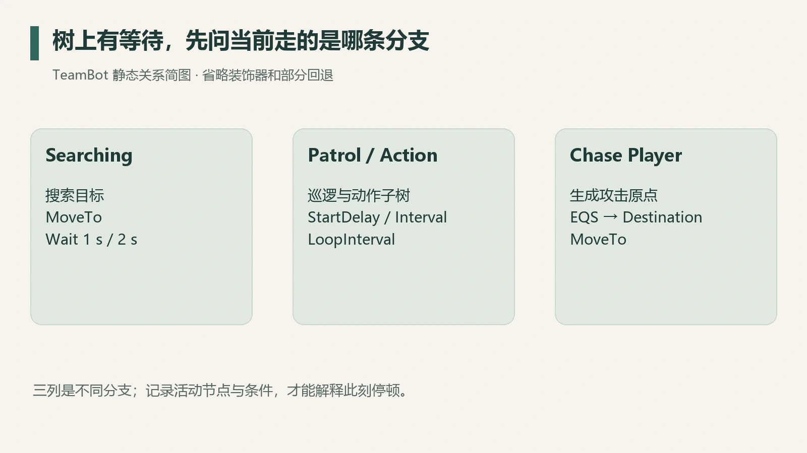
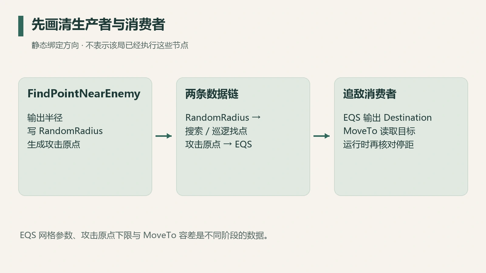

Bot 已能自主追敌，但移动有间隔，而且不会贴近敌人。打开行为树后，里面确实有若干 Wait 节点，也有 `ActionInterval` 和 `RandomRadius` 等字段。这些名字给出候选解释，正在发生的那次停顿需要运行时证据。

2026 年 10 月 3 日的离线调查，使用对应 0.8.1.0 版本的解析 profile 与 USMAP，读取 AI 目录全部 22 个资产、441 个 export，并独立读取 19 个蓝图函数的 Kismet 字节码。

得到的是一份可追溯的数据流解释。当前顿挫的运行时原因仍未确认，这轮读取也没有修改游戏参数。

## 先说明读到了哪一层

22 个资产包括 12 个蓝图生成类、5 棵行为树、4 个 EQS 和 1 个 BlackboardData。第一遍读取序列化元数据；第二遍启用脚本读取，19 个函数均到达 `EX_EndOfScript`，没有脚本解析警告。剔除字节码后，两遍逐包元数据一致。

相比只搜索字段名称，这层数据能说明哪个节点调用哪个函数，哪个绑定写入哪个黑板键。本局正在执行哪条分支、原生父类默认值是多少，需要运行期记录补上。

当前包中的黑板为 41 个键。这个数字描述当前有效资产，其他版本的历史采样单独记录。

## Wait 存在，先看它属于哪条分支

TeamBot 的搜索分支确有 `MoveTo → Wait`：两处显式等待为 1 秒，一处为 2 秒。搜索入口还写入开始延迟与随机偏差，由黑板等待节点消费。

直接追敌分支则进入自己的目标选择与 MoveTo 链。上述搜索 Wait 只属于搜索分支，追敌时刻的执行节点在另一条链上。

*图 1：依静态资产绘制的简化分支图，省略部分装饰器与失败回退；运行栈截图需另行采样。*

[UE 行为树任务文档](https://dev.epicgames.com/documentation/en-us/unreal-engine/unreal-engine-behavior-tree-node-reference-tasks)解释了 Wait 和 Move To 的一般用途。这里的 1 秒、2 秒来自旧版资产，替换成新版引擎默认值会改变结论。

调查可以转成一个明确预测：**若停顿来自搜索等待循环，停顿期应观测到对应 Wait 活跃，并满足 Searching 或失去视线的分支条件。** 如果全程停在追敌 MoveTo，这个解释需要重新检查。

## ActionInterval 只服务于部分移动

四个 SelectAction 服务为巡逻动作填写 `ActionStartDelay`、`ActionInterval`、循环次数等键。实际消费发生在 PatrolAction 或 AboveAction 子树。

直接 Chase Player 分支未挂这四个服务，也未运行这两棵动作子树。因此，降低 `ActionInterval` 与追敌移动的连续性之间缺少连接，改值实验应先补上这条链路。

服务更新间隔也要分开。资产中显式的 service Interval 为 0.001，它描述服务 tick 调度；`ActionInterval` 是动作等待链的输入。单位看似相同，消费者却不同。

SimpleParallel 的完成策略在包中没有显式覆盖，原生默认对象留待补读；副任务等待与主移动的关系需要单独验证。

## 先看清 RandomRadius 是谁写给谁的

追敌链中的 `FindPointNearEnemy`，把 `BB_Out_FindPointRadius` **输出到** `RandomRadius`。搜索和巡逻的随机找点任务之后再读取这个键。

FindPointNearEnemy 是生产者，RandomRadius 是它的输出键，停止距离另有来源。生产者和消费者读反之后，改值实验可能刚写入就被下一轮原生任务覆盖。

*图 2：静态绑定方向。箭头表示写入或读取关系；本局执行了哪些节点需要运行期记录。*

直接追敌的目的地也不是简单的 Enemy Actor。原生任务提供攻击原点，EQS 在其周围生成和筛选候选点，最终输出 `Destination`，MoveTo 消费这个位置。

资产里可见的 `GridSize=200`、`SpaceBetween=80` 是候选网格参数；Distance 测试用于评分，200 是网格间距。

## 静态默认与运行时补证要分开

最初的包读取发现六个 MoveTo 都没有序列化 `AcceptableRadius` 覆盖，本轮读取只到这一层；原生默认值留待补读，常见默认值只能作为待核对照。

随后另一次原生核查记录了两个独立事实：FindPointNearEnemy 的攻击原点计算含 **600 世界单位的下限**；所检查的原节点和运行节点 MoveTo 容差为 **5.0**，并启用角色与目标半径相关的到达判定。

600 作用于攻击原点的生成阶段，5.0 作用于导航请求的到达条件。两者作用在不同阶段，EQS、投影、路径和角色半径还会进一步影响最终站位。

原生核查时，对应追敌计算站点没有命中新鲜的自然追击样本。因此停距由哪个阶段决定，需要同一时段的关联记录；把所有 Bot 的停距写成固定六米，与现有记录不符。

## 下一条证据应当长什么样

为同一个 Bot、同一时段关联以下记录：活动节点与分支条件、Enemy 位置、AttackOriginLocation、EQS 输出的 Destination、MoveTo 请求与最终位移。若研究停顿，还需记录进入和退出等待节点的时刻。

这样才能回答“没产生目标”“有目标但导航没推进”“抵达后正在等待”“被另一个动作中断”等不同问题。每个候选解释都对应一组可观察条件。

这次离线资产阅读的价值，是把模糊的字段猜测变成了可验证的数据链。行为树里有 Wait 是事实；当前停顿由它造成，则需要运行时活动证据。把这两句话分开，下一轮实验可以更小、更聚焦。
