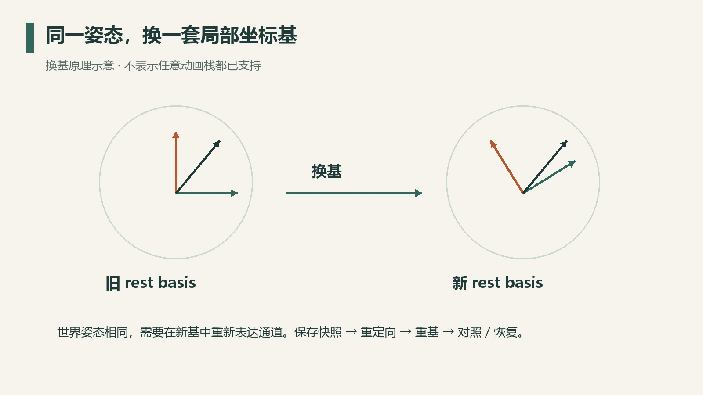
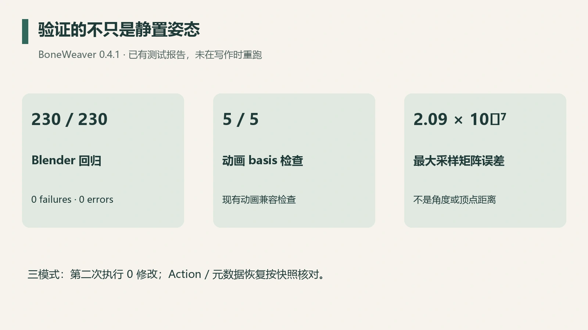

从 UE 导入角色后，骨骼尾部与局部轴不一定适合 Blender 中的编辑。把尾部和 roll 调整得更好操作，改变的除了显示外观，还有动画通道所依附的 rest basis。

旧 Action 仍然存在，关键帧数量也没少，但同一组旋转值已经可能表示另一个方向。这次 BoneWeaver 0.4.1 的动画兼容工作，解决的就是**调整 rest basis 后，怎样保住已有的采样姿态**。

## 动画值依附于坐标基

静置矩阵定义骨骼的局部坐标系，Pose 通道在它之上描述偏移。只改静置坐标基，继续原样解释旧通道，骨架姿态会随之改变。

可以用向量换基理解这个问题：同一个空间向量 $v$，在旧基 $R_o$ 下的坐标是 $a_o$，在新基 $R_n$ 下的坐标是 $a_n$：

$$
v=R_oa_o=R_na_n,\qquad a_n=R_n^{-1}R_oa_o.
$$

这个式子解释换基方向；完整的 Blender Action 转换还需要纳入骨骼层级、缩放、旋转模式和继承规则。Blender 将骨骼的静置信息与 Pose 分开管理，可对照 [Armatures 手册中的原理介绍](https://docs.blender.org/manual/en/4.2/animation/armatures/introduction.html)。



*图 1：换基原理示意，轴与角度用于说明概念；实测数据见下文验证记录。*

## 变化要在父级局部空间计算

BoneWeaver 先保存改动前后的 armature-space rest 矩阵，再消去各自父级，得到 parent-local 矩阵。对旋转部分去除尺度后，计算旧局部基到新局部基的差值：

```python
old_local = old_parent.inverted() @ old_bone
new_local = new_parent.inverted() @ new_bone
delta = rotation(old_local).inverted() @ rotation(new_local)
```

这段是思路缩写。正式实现还处理根骨、退化轴、四元数归一化和已有元数据。

必须消去父级，是因为父骨与子骨可能一起重定向。直接在 armature space 求差，会把父骨变化混入子骨自身的 twist，结果看似补偿了旋转，却容易在层级里重复计算。

UEFormat 的 `post_quat` 元数据也要按它的组合约定累积。这关系到以后再次导入动画时如何解释新基；已有 Action 的兼容则需要另一条路径：保存原求值结果，在新 rest basis 下求出对应的 Pose 通道。

## 先确认能够处理当前动画栈

0.4.1 的适用范围是可安全采样和重写的本地 Active Action。修改之前检查以下情况：

| 情况 | 处理原则 |
| --- | --- |
| 有 NLA strip | 阻断，避免把混合结果误当作单一 Action |
| Pose Driver 或有效 Constraint | 阻断，避免隐藏求值依赖 |
| Action 被多个对象共享 | 阻断，避免连带改写其他使用者 |
| 不支持的 FCurve 路径或属性 | 阻断，避免只重写部分通道 |
| 空 Action | 进入明确的无有效姿态曲线回退 |

这种范围判断直接影响数据正确性。动画栈里有一个没有纳入的消费者，局部矩阵验证就可能遗漏实际使用时的变化。

## 把操作做成完整事务

一次重定向涉及的不只是骨骼位置。静置矩阵、父子连接、相关元数据、Action 曲线及当前时间都可能受到影响。

因此操作顺序是：检查可支持范围，保存快照与采样姿态，执行重定向和动画重基，再比较姿态矩阵。失败时恢复，成功时保留可重复调用的 Restore。

尤其需要检查第二次执行。若同一个计划再次运行还持续改变骨架或 Action，就说明变化量被重复叠加。0.4.1 的 Original、Links Only 和 Hybrid 三模式，都用第二次运行零修改来检查幂等性。

## 如何证明动画保持了原样

静态 T-pose 检查覆盖不到动画。测试应在相同时间点求值，在同一矩阵空间逐骨比较：

$$
\epsilon=\max_{b,t,i,j}|M^{after}_{b,t,i,j}-M^{before}_{b,t,i,j}|.
$$

这个指标比较采样矩阵的元素误差；顶点距离、角度误差和逐帧视觉验收各自需要单独检查。



*图 2：依据 0.4.1 的已有验证报告整理，本次写作未重新运行测试。*

当时的 Blender 5.2.0 LTS 验证记录包括：230/230 回归通过，5/5 动画 basis 检查通过，三模式第二次执行均为零修改；动画事务探针的最大采样姿态矩阵误差为约 $2.09\times10^{-7}$。一个真实 `.blend` 和一份 157 骨的 UE 模型都进行了三模式验证，源文件哈希保持不变。Action 与相关元数据 Restore 也按快照核对。

这些结果覆盖表中列出的输入和采样点。NLA、Driver 或 Constraint 混合的动画栈仍需在修改前显式停下，0.4.1 对这类输入直接阻断。一个可用的骨骼编辑器会同时说清楚它保持了什么，以及哪些动画栈会被提前拦下。

项目源码见 [BoneWeaver](https://github.com/dotm5/BoneWeaver)。本文描述已保存的 0.4.1 本地验证记录，远端发布状态以仓库为准。
