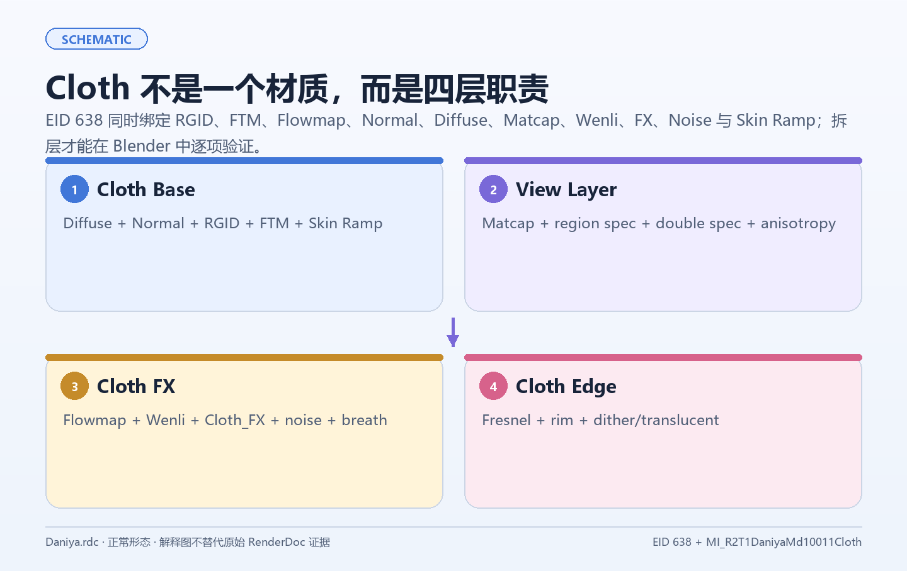
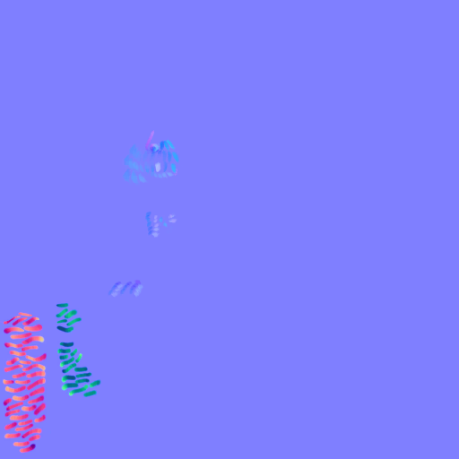
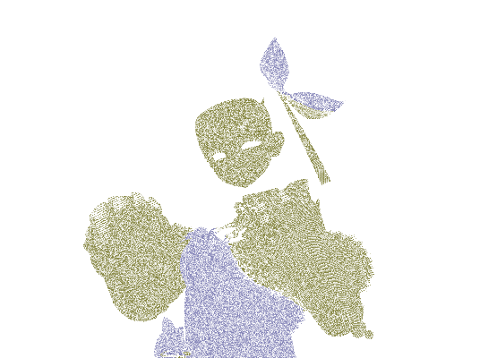

布料往往是角色材质里最容易失控的一族。它既有普通底色和法线，又可能包含金属饰件、区域粗糙度、Matcap、流动纹理、边缘光、透明、微扰噪声和呼吸效果。把这些全部塞进一条颜色乘法链，最后很难知道是哪一层制造了错误。

更适合迁移的方式，是把 Cloth 看成一个按职责排列的层堆栈。

## 1. P0：先建立静态主体

第一版只处理：

- Diffuse/Base Color；
- Normal；
- 区域 ID 或区域 mask；
- FTM/材质类型选择；
- 基础 Ramp；
- 受控的 roughness、metallic 和主高光。

区域 ID 不应直接当作连续灰度。可以先将它离散成有限的材质区域，再为每个区域读取不同参数。这比在节点中堆叠许多条件更容易调试，也更容易记录 Profile。

## 2. P1：视角与材质风格

Matcap 适合给布料增加稳定的视角形状，用法是受控增益，叠加在基础颜色之上：

~~~text
base = toonDiffuse(baseColor, normal, light)
matcap = sampleMatcap(viewNormal)
result = mix(base, base × matcap, matcapWeight)
~~~

matcapWeight 必须可调且默认有界。若把 Matcap 直接接到 Emission，布料会脱离场景光照；若把它直接替换 Base Color，则法线和局部灯光的诊断会失去意义。

## 3. P1：Flowmap 与纹理运动

Flowmap 负责方向，纹理负责内容，时间负责运动。三者应保持分离：

~~~text
flowDirection = decodeFlow(flowmap)
uvAnimated = uv + flowDirection × speed × time
effect = sample(effectTexture, uvAnimated)
~~~

如果当前证据只能确认存在流动输入，而不能确认其具体业务用途，就把它标为可选 FX 输入，不命名成某种游戏专属效果。

## 4. 噪声、边缘和透明

噪声适合做微扰、抖动和 dither，但不应该掩盖法线或 UV 错误。边缘层可以使用 Fresnel、视角法线或深度信息，但要把它与真正的轮廓几何区分开。透明则需要单独验证排序、裁切和阴影。

分层顺序：

1. 静态基础层；
2. 区域参数；
3. Matcap/视角层；
4. Flowmap/FX；
5. Noise/Dither；
6. 透明和动态边界。

每一层都有开关，且关闭后应回到上一层的稳定结果。

## 5. Fur 作为局部覆层

毛绒效果通常表示为 Cloth 上的局部覆盖：

- Fur Mask 决定出现在哪里；
- 额外法线或 shell 提供表面厚度；
- Alpha/Dither 控制边缘；
- 视差层只在近景启用。

首版可以使用复制面、Geometry Nodes shell 或第二材质。远景用单层 mask，近景再增加少量几何层。毛绒层数、步进和真实微表面模型在证据不足时都应标为 approximation。

## 6. 性能和可维护性

布料层数越多，采样、带宽和透明排序的成本越高。实际项目中可以把层拆为质量档：

- Low：Base + Normal + Ramp；
- Medium：增加区域参数与 Matcap；
- High：增加 Flowmap、FX 和边缘层；
- Close：增加 Fur shell、透明细节和高质量噪声。

质量档不删除未知输入，而是明确哪些输入在当前档位不消费，避免诊断结果把“关闭”误读成“原材质没有这个能力”。

布料迁移的目标是让每一层都有明确职责、开关、默认值和验证方式。
