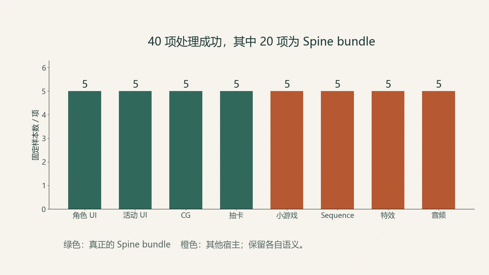
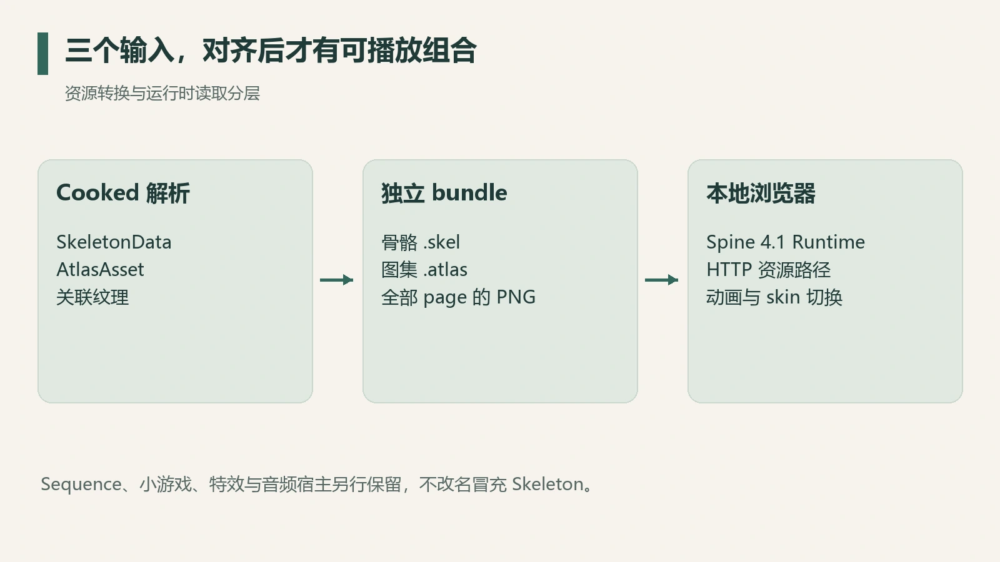

UE 资源包里出现 `Spine` 时，同一条引用链上可能同时连着 Skeleton 数据、Atlas、纹理、小游戏配置、Sequence 和事件宿主，各自承担不同职责，其中只有一部分能直接播放。

这次鸣潮 Spine 研究的目标，是把真正可播放的数据从这些宿主关系里分离出来，生成独立的 `.skel + .atlas + .png` 组合，再交给本地浏览器运行时。

最终固定样本为 8 类、每类 5 项，共 40 项，处理成功 40 项；其中 20 项是真正的 Spine bundle。另外 20 项保留各自的 Cooked 包、属性或转换数据，按宿主数据归档。

## 先按数据角色分类

按播放器真正需要的输入，可以将资源分为四层：

| 层 | 数据角色 | 是否直接交给 Spine Player |
| --- | --- | --- |
| SkeletonData | 骨骼、slot、skin、动画时间轴 | 是，重建为匹配格式的骨骼数据 |
| Atlas 与纹理 | region、page、UV 和像素 | 是，保持页名与相对路径一致 |
| 配置与 Sequence | 管理动画调用、组件或时间线 | 否，先解释宿主逻辑 |
| 特效与音频事件 | 关联显示或声音效果 | 否，保留自己的资源语义 |

一个宿主对象引用 Skeleton，它承担的仍是宿主职责。把所有文件都换成 `.skel` 只会增加文件数量，数据角色反而丢失。

*图 1：来自固定 8×5 样本。前四类为 Spine bundle，后四类是其他数据或事件宿主；各类“成功”按各自输出标准计。*

## 一个可播放组合需要三份数据对齐

Skeleton 定义骨骼和动画。Atlas 告诉运行时每块图像位于哪一页、哪个区域。PNG 提供实际像素。三者中的任意一部分错位，都可能出现白块、缺图或错误裁切。

多页 Atlas 需要核对：每一页的文件名都要能从 Atlas 所在目录正确解析。只导出第一张 PNG，或复制时改名却不同步 page 记录，都会让运行时找不到纹理。

此次 20 个真实 bundle 生成了 28 个 `.skel`、20 个 `.atlas` 和 21 张 PNG。一个 bundle 可以包含多个 Skeleton，或者多页 Atlas，所以这三个数量并不一一相等。

*图 2：运行时输入关系示意。浏览器只读取转换后的资源，不在运行时解析 UE Cooked 包。*

文件存在只说明导出完成，纹理解码还需要单独信号。本次转换遇到的问题之一，是压缩纹理解码辅助库没有先初始化；修正初始化顺序后，固定样本转换才完成。读取器与解码器各自的成功信号，应分开检查。

## Runtime 版本要与数据匹配

本次骨骼数据记录为 Spine 4.1.23，本地播放器固定使用 `spine-player@4.1.55`。安装工具默认提供“最新版本”，这里改按数据版本固定在同一条主次版本线上。

[Spine 的版本管理说明](https://esotericsoftware.com/spine-versioning)要求导出数据与 runtime 版本相匹配。版本信息是解析契约的一部分；仅改文件里的版本字符串，不会自动转换底层数据结构。

对旧资源的互操作研究，固定版本还有一个实际好处：将来重跑时，可以区分资源变化与运行时变化，避免两边一起升级后找不到差异来源。

## 播放器保持独立

本地展示采用 Node.js 内置 HTTP server 与浏览器 WebGL。JS、CSS、runtime 和数据均由本地目录提供，不依赖 CDN，也不需要运行 UE 或游戏进程。

HTTP 服务负责避开 `file://` 的资源请求与跨来源限制，把这类问题与资源转换问题分开。

切换 bundle 时，需要销毁旧实例并重新绑定新数据；查看某个动画时，还应核对默认 skin、setup pose 与动画名。黑边或白边则应检查纹理的 premultiplied alpha 设置。官方 [Skeleton Viewer](https://esotericsoftware.com/spine-skeleton-viewer)也将 Atlas 和 PMA 作为核验项。

## 三层验收：数据、显示与宿主行为

验收可以按三个层次逐步推进：

1. **数据完整性**：Skeleton 可解析，所有 Atlas 页可定位，纹理解码成功，动画名可枚举。
2. **运行时显示**：播放器完成初始化，代表性动画能切换、循环，页面和 skin 没有缺失。
3. **宿主行为**：原 UE 组件怎样选择动画、混合、切换状态，是否还依赖 Sequence、特效或音频。

前两层成立时，第三层仍待实测：播放器能展示骨骼动画，原小游戏或剧情组件的行为需要各自的记录。

Wallpaper Engine 音频响应壁纸是后续设计方向，现有记录尚未覆盖其宿主实测，不计入已完成结果。公开教程可以展示分类方式和加载流程；Spine runtime 与示例数据则应遵循各自的许可，本文不附原游戏资源包。

这个项目最可复用的成果，是一条清楚的数据边界：Cooked 包用于研究与转换，独立 bundle 用于播放，宿主逻辑另行分析。每一层有自己的输入与验收，才能判断下一次失败究竟发生在哪里。
