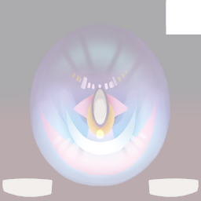
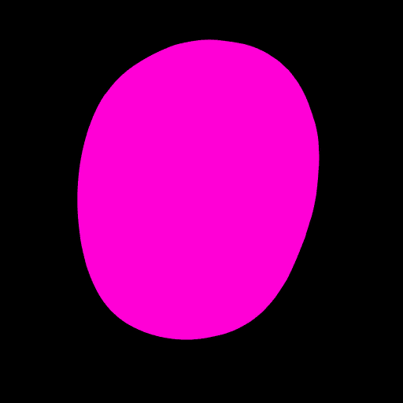
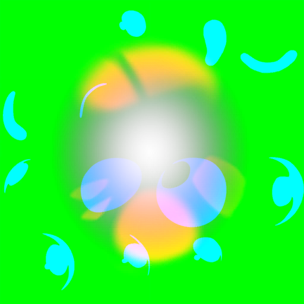

眼睛经常被当作 Face 材质上的一块颜色，但它拥有完全不同的空间关系：虹膜需要视差，瞳孔需要保持稳定，主高光和次高光需要独立控制，眼区边界还会影响刘海与脸部遮罩。

把眼睛拆出来，是为了让每一个视觉现象都有一个可以单独关闭和验证的来源。

## 1. 三套坐标各自独立

眼睛至少有三种坐标概念：

1. **Diffuse UV**：决定虹膜底图在哪里采样。
2. **Highlight 坐标**：决定高光落在眼球的哪一个局部位置。
3. **View/Tangent 坐标**：决定观察角度变化时，虹膜如何产生轻微偏移。

它们可能来自同一套 UV，也可能来自不同的辅助输入。迁移到新模型时，先分别渲染 UV 对照图，再决定哪些坐标可以共用。名为 Eye 的材质不保证所有高光和遮罩都使用同一套 UV。

## 2. 视差需要限幅

眼睛视差的目的，是让虹膜在轻微转头和相机移动时仍有深度感，同时防止虹膜漂离眼球。一个安全的模型是：

~~~text
offset = viewTS.xy × height × mask
offset = clamp(offset, allowedRange)
irisUV = baseUV + offset
~~~

其中 height 可以来自高度图或一个可调值，mask 负责限制虹膜区域，allowedRange 则是为了避免极端视角穿出眼区。动画验证时要把头部旋转、相机小幅移动和正面静止分开测量。

## 3. 高光要分层

至少可以分为：

- 主高光：表达眼球的主要亮点；
- 次高光：提供偏移或形状变化；
- Height Light：更像贴图控制的局部亮度层；
- 边缘或环境响应：只在需要时叠加。

这些层不应全部合并为 Principled 的一个 Specular 参数。合并后虽然能快速得到“亮眼睛”，却无法分别调位置、宽度、旋转和透明度，也无法判断问题来自底图、mask 还是高光层。

## 4. 眼区遮罩是材质接口

眼区 mask 的职责包括：

- 限制刘海投影只影响应当覆盖的区域；
- 防止脸部 Ramp 把虹膜整体压暗；
- 让透明代理或眼睑层拥有明确边界；
- 为诊断渲染提供稳定的像素集合。

在 Blender 中可以将它变成显式 Image Mask、顶点颜色、属性字段或单独的眼球几何。需要保留的是“谁影响谁”的关系；底层缓冲的存储方式按引擎实际实现选择。

## 5. Eevee 节点组织

可以建立一个 Eye Core：

~~~text
Eye Diffuse
   ├─ Iris / Pupil
   ├─ View Parallax
   ├─ Main Highlight
   ├─ Secondary Highlight
   ├─ Eye Region Mask
   └─ Alpha / Overlay
~~~

Eye Core 只接受统一的输入接口，不直接读取其他角色的内部命名。每个角色通过 Profile 指定 UV、贴图色彩空间、mask 极性和高光默认值。

## 6. 验证顺序

先关闭所有高光，只验证虹膜底图和眼区 mask；再打开视差，比较正面和三分之四视角；最后逐层打开主高光、次高光和 Height Light。每次只改变一个变量。

如果眼睛在正面正确、侧面错位，优先检查 UV 和视差空间；如果虹膜正确但高光漂移，检查高光坐标；如果眼睛被刘海覆盖错误，检查 Eye Region 与 Bangs Mask 的组合；眼睛颜色最后再动。

眼睛的独立性最终服务于可控性：视觉复杂度可以保留，验证复杂度则随之下降。
