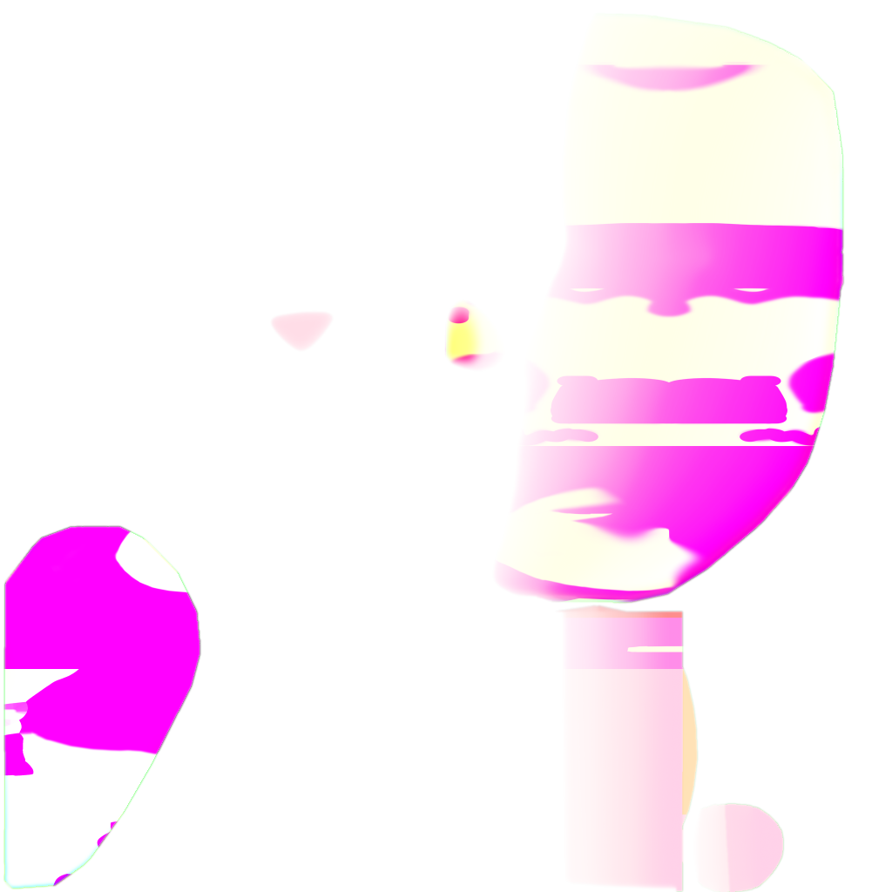

面部是角色 NPR 中最容易“整体正确、局部失真”的部分。只用世界空间的 N·L 做阶梯化，鼻梁、眼眶、刘海遮挡和脸部绘画式明暗很快会互相打架：灯光一转，阴影像贴在脸上；相机一动，面部层次又显得过硬。

会话中的核心思路，是把面部阴影当成“头部局部空间中的方向问题”处理，独立于身体材质。SDF 负责提供脸部区域的可控边界，Ramp 负责把连续信号变成稳定的美术分档。

## 1. SDF 解决的不是所有问题

距离场适合表达“某个区域离边界有多近”或“从某个方向看，阴影应该推进到哪里”。它可以帮助面部阴影在鼻翼、眼眶和脸颊附近保持稳定，但它并不自动回答：

- 阴影应当使用哪一侧的方向；
- 哪一行 Ramp 对应哪一种肤色；
- 刘海是否要覆盖一部分脸部结果；
- 眼睛高光和透明代理是否需要独立合成。

因此 SDF 只是输入之一，必须和头部方向、Face ID、区域 mask 以及主光方向共同使用。

## 2. 先把光方向变换到头部空间

面部逻辑通常需要一个稳定的头部坐标系。Blender 中可以使用头骨或一个跟随头部的 Controller 提供：

- 头部前向；
- 头部上向；
- 头部原点；
- 主光方向在该空间中的投影。

核心关系可以写成：

~~~text
lightWorld → headSpace(light)
headSpace(light) + faceMask + sdf
                 ↓
             shadow scalar
                 ↓
             skin ramp
~~~

如果只移动太阳灯而没有更新头部空间，SDF 采样会在角色转头时失去一致性。反过来，如果把头部方向写死，也会让所有姿态共用同一个脸部明暗方向。

## 3. Ramp 的任务是稳定艺术决策

Ramp 把灰度变成稳定分档。在面部中，它可以承担：

- 把阴影宽度固定在美术可控范围；
- 为皮肤、眼眶、嘴唇等区域提供不同色阶；
- 让主光变化不至于把整张脸冲成连续 PBR；
- 给不同材质 Profile 提供可替换的色彩策略。

将 Ramp 作为独立输入，不烘进 Face Diffuse，可以分别测试“贴图颜色是否正确”和“阴影分档是否正确”。

## 4. 刘海和眼睛要成为独立遮罩

面部最终颜色经常受到前发投影、眼区遮罩和透明层影响。一个稳妥的节点顺序是：

1. 读取 Face Diffuse 和 Face ID；
2. 将主光转换到头部空间；
3. 计算 SDF 阴影；
4. 通过 Face ID 选择 Ramp 或颜色修正；
5. 合成刘海投影 mask；
6. 叠加眼睛层，但保留眼睛自己的高光和视差；
7. 输出基础面部颜色、诊断 mask 与边界结果。

刘海阴影不应直接涂进面部底图，眼睛也不应被当作面部 Base Color 的一小块。它们在空间关系和验证方式上都不同。

## 5. Blender 中的诊断口

为了让 SDF 调参可解释，可以暴露以下 AOV 或节点输出：

- FaceID：确认区域分类；
- HeadLightX/Y：确认头部空间光方向；
- SDFRaw：确认贴图本身是否正确；
- SDFShadow：确认阈值与平滑；
- RampRow：确认选择了哪组色阶；
- BangsMask：确认刘海投影是否越界；
- FaceFinal：最终面部材质结果。

## 6. 如何做最小 A/B

固定相机、姿态、分辨率和色彩管理，只改变主光从左到右；然后只改变 SDF 的左右翻转开关；最后只改变 Ramp 行。每次都保存原始值、A 图、B 图和差分。

如果左右光下阴影方向反了，优先检查头部坐标系和 UV 方向，不要先调颜色。如果 FaceID 正确但脸颊和眼眶的分档错误，检查 Ramp 选择和 mask 极性。如果只有刘海附近错误，单独关闭 BangsMask 进行隔离。

公开重建可以确认“面部使用头部空间、SDF 和 Ramp 组织阴影”；原始 SDF 公式、采样空间和未触发分支保留为可验证的候选。

面部 NPR 的核心是一条空间一致、区域清晰、可逐层诊断的材质链。
