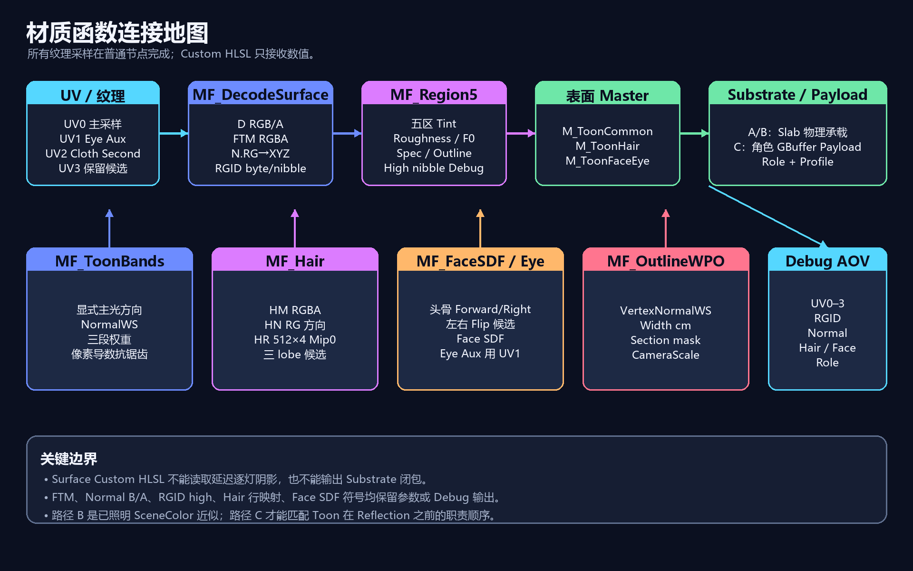

很多渲染分析从一句“这张图看起来像某种卡通材质”开始，最后停在一堆猜测里。问题在于最终画面已经把多个阶段混在了一起：材质写入、区域路由、专用光照、反射、后处理都可能改变同一个像素。

把一帧画面当成一个待验证的行为系统。先确认发生了什么，再讨论它为什么这样设计，最后才决定 Blender 中用什么节点或几何表达。

*这张图来自会话中的模块化复刻思路。公开稿只保留职责边界，不把任何内部身份当成可复制的实现细节。*

## 1. 先冻结输入，再调颜色

一次分析至少要记录：

- 捕获是否可以稳定回放；
- 相机、姿态、分辨率、曝光和色彩管理；
- 当前模型的可见 section、材质槽和纹理预览；
- 每个阶段读写了哪些中间资源；
- 哪些输出是原始预览，哪些是为了说明而绘制的示意图。

输入不冻结，后面的差分就没有意义。比如换了 LOD 之后，顶点数量、法线和 UV 都可能改变；换了相机之后，眼睛视差、头发高光和轮廓宽度也会同时变化。此时即使最终颜色更接近，也无法判断某个材质模块是否被正确重建。

## 2. 用四层证据回答四类问题

### 几何层：谁在画

不要只按屏幕位置认领一个 draw。把离线模型的 section、索引范围、材质槽和运行时几何覆盖关系放在同一张表里。几何范围能回答“这次提交是否真的对应这个部件”，而事件名称只能作为检索线索。

### 资源层：读到了什么

把纹理、缓冲和常量先当作输入候选，不急着给它们命名。一个叫 Mask 的输入可能是区域选择、方向场、透明控制或查找表；只有它与输出差分、材质角色和空间关系同时闭合，才适合升级为语义结论。

### 管线层：什么时候生效

同一份数据在表面阶段写入，可能在延迟光照阶段才被解释。区域遮罩、深度、颜色写掩码和后续全屏阶段的先后关系，比单张终帧截图更能说明设计意图。

### 输出层：确实改变了什么

优先比较最早可能发生变化的中间输出，再看最终画面。若只比较最终图，很容易把多个阶段的变化归到最后一个看起来最像“光照”的模块。

## 3. 把事实和解释分开写

使用两套标签：

| 标签 | 含义 |
| --- | --- |
| confirmed | 由资源、状态、几何或稳定差分直接支持 |
| inferred | 多条证据共同指向，但仍存在替代解释 |
| candidate | 为实现或下一次实验准备的可调方案 |
| unknown | 当前证据不能唯一命名或定位 |

另加一套保真度标签：exact 只表示当前数据可以原样复用；approximation 表示重建的是可见行为；unresolved 表示还没有足够数据。这样“已经知道它做什么”和“已经恢复了原始实现”不会被混为一谈。

## 4. 从证据图到 Blender

Blender 侧的做法是先建立一个语义接口，原始数据布局按接口映射：

~~~text
原始输入 → 语义 Profile → 共享 Toon Core
                  ├─ Face / Eye
                  ├─ Hair / Bangs
                  ├─ Cloth / Fur
                  ├─ Geometry Layers
                  └─ Diagnostic AOV
~~~

Profile 负责回答“这个项目里的输入是什么”，共享核心负责回答“统一的 NPR 逻辑怎么画”。几何节点负责反壳、持久属性和跟随姿态的层；合成器负责屏幕空间边缘、色彩和最终表现。每一层都应能单独开关和输出诊断结果。

## 5. 分析的停止位置

如果已经确认角色使用了独立的风格化光照阶段，但没有足够证据证明某个通道的具体业务名称，就停在“角色专用 Toon 控制量”这一层。继续向下猜名字，可能让整套 Blender 节点建立在错误语义上。

同理，某个后续反射阶段没有明显改变当前缩略图，说明这一次观察中没有测到可见增量；整个角色材质在反射中的参与范围需要更多帧。

分析中最危险的一句话是“我还不知道”。把一次帧观察写成跨版本、跨角色、跨场景的通用规则，危害更大；每个结论都带上适用范围。

## 6. 一张可复用的检查表

1. 输入是否冻结并可重复打开？
2. 几何身份是否由范围和状态共同支持？
3. 纹理或缓冲是否真的影响了当前输出？
4. 表面、路由、光照、反射和后处理是否分层记录？
5. 事实、推断、候选和未知是否分开？
6. Blender 版本、渲染器、颜色管理和相机是否写入验证合同？
7. 每个模块能否独立诊断、关闭和回滚？

这套流程的价值，在于它能把“看起来像”转化为“哪一层、哪一类证据、在什么条件下支持了什么行为”。它也让后续迁移更容易：即使原始实现永远不可见，行为合同仍然可以被逐模块验证。
