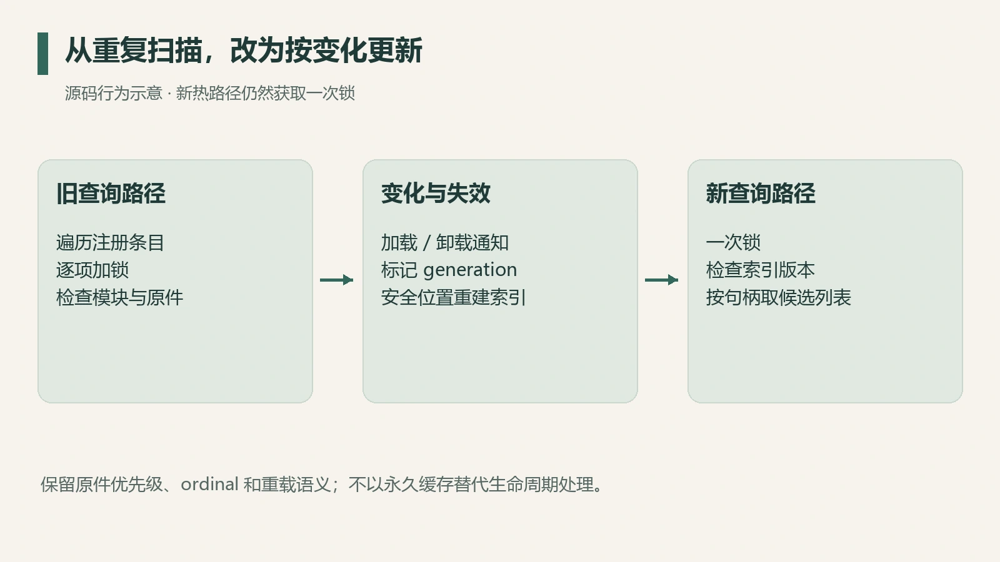
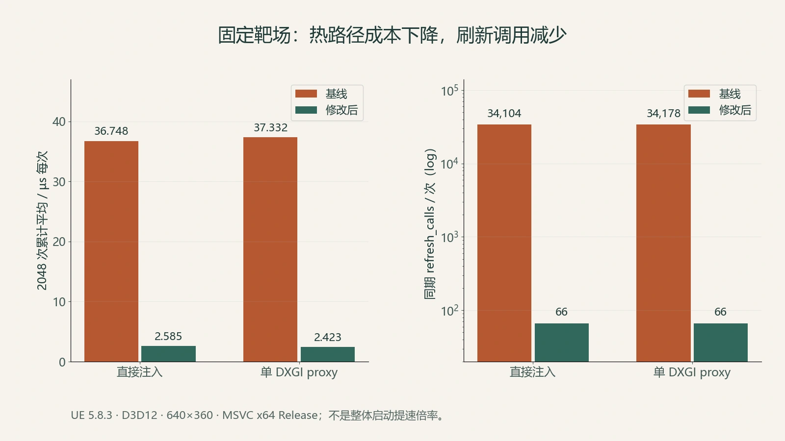

某段 Hook 代码启动时很慢，最先被怀疑的往往是 Hook 引擎或者指令解码器。但这次逐行核对后发现，`GetProcAddress` 查询路径并没有每次重新安装 SafetyHook，也没有每次运行 Zydis。

重复发生的工作是：遍历注册的模块条目，逐项获取锁，并检查模块绑定状态。优化因此集中在刷新频率、句柄查找方式和同步范围，Hook 引擎保持原样。

2026 年 9 月 30 日的固定靶场对照中，直接注入和单 DXGI proxy 两条路径的热路径累计平均耗时，分别从 36.748、37.332 µs/次降到 2.585、2.423 µs/次。

## 先修正成本模型

旧实现逐项遍历 `DllHooks`。当时有 13 个注册条目，各自刷新成本不同；按最贵路径乘以 13 会高估总成本。

源码核对纠正了两处过度概括：System32 规范路径逻辑主要针对 DXGI 和 D3D11；`RefreshOriginalModule` 在原件选择未变化时会提前返回，稳态下存活检查的执行次数少于条目数。

仍然成立的固定成本，是全表遍历、逐项锁和未绑定条目的重复查询。早退位置决定真实成本。

*图 1：根据前后实现整理的流程示意；新版本仍保留一次锁。*

## 缓存必须有失效规则

按 `HMODULE` 找候选 Hook，可以减少不相关条目的搜索，但句柄不能被当成永久身份。模块会卸载、重载，地址也可能复用。

同时，一个句柄可能对应多个 API-set 或注册条目。索引需要保留候选列表和原有优先顺序；“一个句柄一套 Hook”会丢失多条目映射。共享原始函数槽的首次选择规则，也属于已有行为。

修复版将模块变化计入 generation。通知回调只记录相关变化；下一次在安全的同步范围里更新索引，重新核对原件、ordinal 和备用模块。模块卸载使相关记录失效，重载时重新解析。

通知回调有加载期约束，适合做轻量标记；直接在回调里承担任意解析与复杂改写有额外风险。[LdrDllNotification 的官方说明](https://learn.microsoft.com/en-us/windows/win32/devnotes/ldrdllnotification)给出了它触发于动态链接之前的边界。

新热路径每次获取一次锁，确认索引是否需要刷新，然后按句柄访问候选条目。通知不可用时保留保守刷新路径，模块变化始终计入刷新。

## 用同一个靶场、同一个计时口径比较

测试固定在 UE 5.8.3 官方第一人称模板的 Windows 打包程序：MSVC x64 Release、D3D12、640 × 360、窗口模式。两版加入相同的计时输出，分别执行直接注入与单 DXGI proxy 的独立冷启动，每轮捕获一帧。

指标取第 2048 次调用时的累计记录：

| 指标 | 直接注入：基线 → 修改后 | DXGI proxy：基线 → 修改后 |
| --- | --- | --- |
| 平均耗时，µs/次 | 36.748 → 2.585 | 37.332 → 2.423 |
| 累计耗时，µs | 75,260.3 → 5,295.0 | 76,455.2 → 4,962.5 |
| `refresh_calls` | 34,104 → 66 | 34,178 → 66 |
| 模块匹配 `hits` | 974 → 974 | 1,005 → 1,005 |
| RDC 写盘 | 两版均成功 | 两版均成功 |

`hits` 是模块候选匹配口径，与最终返回 Hook 函数的次数相差一层。`refresh_calls` 描述计数位置上的刷新调用；模块真正重绑定的次数单独统计。

*图 2：依据固定对照日志的第 2048 次累计记录绘制。单轮记录，没有重复轮次误差条；每次调用的耗时分布更宽。*

原始日志核对后，平均耗时比约为 **14.22×** 与 **15.41×**。计时包含相同仪表开销，可以比较这两组实现；不同阶段和并发负载下的完整分布需要单独测量。

## 启动时间为什么只缩短了一点

热路径只是启动工作的一个组成部分。引擎初始化、资源读取、模块遍历和图形对象创建仍然消耗时间。

两条路径中，`HookAllModules` 的累计耗时没有一致下降：直接注入从约 1414 ms 到 1327 ms，proxy 则从约 1070 ms 到 1161 ms。引擎初始化日志分别为 4.07 → 3.64 秒，以及 3.53 → 3.53 秒。

这些单轮观察不能全部归因于热路径改动。本文确认的是固定测试中的函数查询平均成本改善；应用整体启动时间另算。

测试过程中，双 proxy 组合曾触发栈溢出；正式比较使用能够启动与捕获的单 DXGI proxy。路径变化必须记录，失败样本单独列出。

## 优化之后还要保住什么

微软的 [GetProcAddress 文档](https://learn.microsoft.com/en-us/windows/win32/api/libloaderapi/nf-libloaderapi-getprocaddress)区分名称与 ordinal 查询。优化后的边界核对仍应覆盖：自模块透传、未知模块、ordinal 越界、卸载重载、代理与系统原件的先后加载，以及共享原始函数槽的优先级。

现有前后运行与 RDC 支撑这次靶场结果；所有并发及模块生命周期组合仍需覆盖。后续若要推广，应该补这些场景的比较，并拆分冷启动、稳态和真实重绑定的计数。

这轮最可迁移的思路，是先把重复工作定位到真实调用链，再为缓存写出失效规则，最后用固定条件报告收益。换更快的解码器属于另一条路径，成本仍留在模块刷新上。
