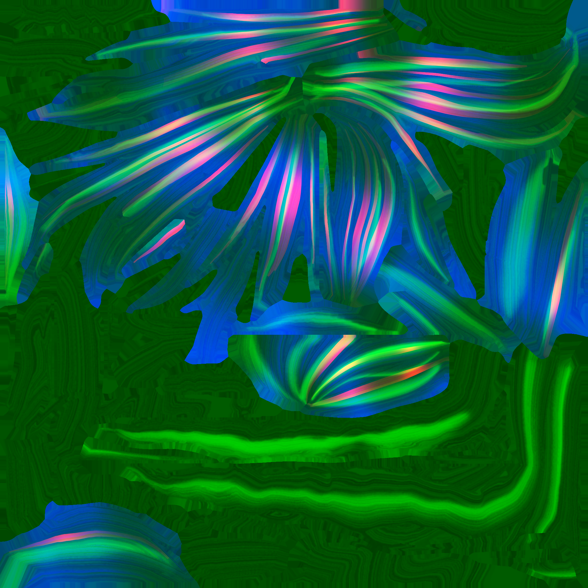
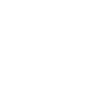
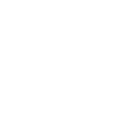
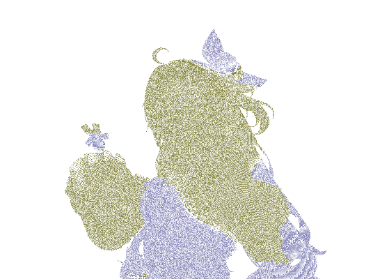

头发的绘画式高光有一个明显特征：它不完全服从传统 PBR 的半角向量。高光会沿着发束方向拉成带状，位置由局部纹理和方向控制，宽度又受到区域、视角和美术参数影响。

降低 Roughness、提高 Specular 只能得到一片连续亮斑，无法得到可控的发束高光。

## 1. 把头发输入分成三类

### 区域输入

区域 mask 决定哪些发束属于同一组，哪些边界需要降低高光，哪些区域需要额外的边缘提升。它通常是“在哪里画”的信息。

### 方向输入

法线、切线或专门的方向纹理决定“沿哪个方向画”。方向场不一定等于几何切线，它可能是经过美术修正的二维流向。

### 响应输入

渐变表、查找纹理和局部 FX 决定“画成什么样”。它们可以控制亮度、颜色、宽度、边缘衰减或闪烁，但仅凭文件名无法猜出业务含义。

## 2. 一个可迁移的行为模型

可以把一组高光抽象成：

~~~text
bandMask = regionMask × directionalResponse
bandValue = lookup(shiftedCoordinate, ramp)
highlight = bandMask × bandValue × viewWeight
~~~

这里不需要知道原始系统的采样指令，只要能稳定表达三件事：局部区域、发束方向和最终响应。

至少建立三组独立高光带，每组拥有自己的位置、宽度、颜色、边缘提升和开关。这样可以通过 A/B 观察某个发束错误究竟来自方向、mask 还是颜色。

## 3. 方向场处理

方向场以 Non-Color 方式读取，并明确其坐标空间。将它当作 sRGB 颜色直接参与运算，会把数值空间扭曲，表现为高光方向随着亮度变化而漂移。

如果模型会动画变形，几何切线与静态贴图方向可能不再一致。优先使用 Blender 的变形后切线空间；只有在静态模型或证据明确时，才使用导入的自定义 TBN。## 4. Sparkle 和 FX 放到第二阶段

头发闪烁、噪声、流动和微小颜色变化很容易掩盖基础材质错误。分两层实现：

1. P0：Base、Normal、区域 mask、方向输入、Ramp 和静态三组高光；
2. P1：Sparkle、FX、时间函数、局部闪烁和动态边缘。

第一阶段如果没有稳定的发束形状，就不应通过增加发光或噪声来“补回”画面。动态层默认关闭是可验收的结果。

## 5. 透明与双面

刘海和碎发可能使用透明或双面材质。把透明裁切直接交给高光节点会让轮廓、深度和排序问题变得难以诊断。可行的拆分是：

- Cutout/Opacity 单独输出；
- 高光只在有效表面上计算；
- 轮廓几何层另行处理；
- 透明边缘用固定条件的近景和运动镜头验证。

## 6. Blender 节点组织

Hair Core 可以暴露：

- Base Color；
- Normal/Direction；
- Region Mask；
- Highlight Band 0/1/2；
- Ramp 或 Lookup；
- Edge Lift；
- FX Enable；
- Diagnostic 输出。

Hair 和 Bangs 可以共享核心，但不应强行共享所有参数。刘海经常还承担脸部投影或眼区覆盖关系，需要额外的 Projected Region 输入。

## 7. 验证方式

固定主光方向，分别关闭方向场、区域 mask 和 Ramp；再固定材质，只改变相机方向。若关闭方向场后高光仍然沿发束保持正确，说明另一个输入在承担同样职责；若仅改变颜色却造成高光位置变化，应检查查表坐标或色彩空间。

头发高光真正可迁移的是“区域 × 方向 × 响应”的接口，而非某张纹理的文件名。
