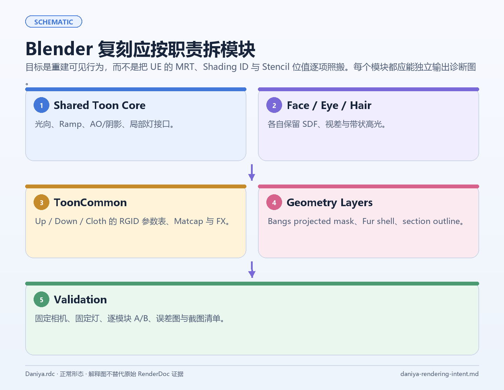

把一个游戏角色迁移到 Blender，有两条常见但走不通的路：把大量引擎专属参数硬编码进一棵巨型节点树，或者只接几张贴图，得到一个“有颜色但没有行为”的模型。

可持续的结构是把迁移拆成 Profile、语义适配、共享核心、角色模块、几何层、合成器和验证层。这样每个项目只需要替换输入描述，核心 NPR 逻辑仍然可以复用。

## 1. Profile 负责描述项目差异

Profile 不仅记录材质名称，还包含：

- Material Role：Body、Face、Eye、Hair、Cloth 等；
- 纹理到语义槽的映射；
- UV 选择规则；
- 色彩空间；
- mask 极性和通道；
- 头部方向与模型轴；
- 可用的 Feature Flag；
- 当前证据等级和未映射项。

同一个输入键在 Face 中可能是 SDF，在 Hair 中可能是高光 mask。映射的键用“材质角色 + 输入键”，全局的“某个名字永远代表某种语义”不可靠。

## 2. 语义适配层隔离文件格式

适配层读取 JSON、纹理引用、材质槽、模型属性或手工 Profile，输出统一的语义接口：

~~~text
项目输入
  ↓
Role + Profile
  ↓
Semantic Surface
  {base, normal, region, ramp, direction, alpha}
  ↓
Shared Toon Core / 专用模块
~~~

这一层可以处理路径、扩展名、UV 和通道差异；Shader Core 不需要知道数据来自哪一种引擎导出格式。

## 3. 共享核心与专用模块

Shared Toon Core 只保留共性：

- 主光方向；
- Normal 与 View；
- 阴影分档；
- Ramp；
- AO/Shadow；
- 有界的局部灯接口；
- 通用诊断输出。

专用模块再处理：

- Face：头部空间、SDF、Face Region；
- Eye：独立 UV、视差、高光；
- Hair：方向场、区域、高光带；
- Cloth：区域参数、Matcap、Flowmap、FX；
- Fur：局部覆层或 shell。

这种拆法能避免“为了支持一个新角色，把所有材质都复制一份”的增长方式。

## 4. 材质、几何和合成器要有边界

材质节点适合处理片元局部的颜色、法线、mask、Ramp、alpha 和有限的视角响应。Geometry Nodes 适合处理轮廓壳、持久属性、局部几何层和跟随动画的结构。合成器适合做 Normal/Mist/AOV 边缘、色彩和最终表现。

如果某个效果依赖目标引擎的延迟 GBuffer、Stencil 或 RenderGraph 顺序，应明确标成 approximation 或 loss，不能悄悄藏在一个颜色常量里。

## 5. 四种工作模式

每个材质可提供：

- Baseline：保留原始 surface link；
- Approximate：接入可见行为的近似实现；
- Diagnostic：显示 Base、Normal、Mask、Ramp、UV、Alpha 和 Outline；
- Recovered：只有完整证据链闭合时才允许启用。

在当前项目的公开稿中，绝大多数迁移结果应停留在 Approximate 或 Diagnostic。这样既能推进画面，又不会让“节点存在”被误读成“原始实现已恢复”。

## 6. 回滚与重复应用

生成的节点和几何层要统一命名、可定位、可删除；输入表面链接要保留；主开关要能恢复原材质。脚本重复运行两次时，节点数量、材质关系和输出合同与第一次一致。

回滚是研究型 Shader 工作流的一部分。没有回滚，就无法可靠地做单变量 A/B。

## 7. 适合长期维护的验证产物

每个 Profile 旁边保留一份机器可读的 mapping：

| 输入 | 语义 | 目标 | 证据 | 状态 |
| --- | --- | --- | --- | --- |
| 原始纹理/通道 | Base/Normal/Mask 候选 | 节点或未绑定 | 直接观察/差分 | confirmed 或 unknown |
| 区域字段 | 离散角色选择 | 参数表 | 多材质重复 | inferred |
| 屏幕空间效果 | 深度/边缘关系 | 合成器近似 | 阶段输出 | approximation |

这份表比“某个节点已经接上”更能帮助后续接手者理解当前系统。

迁移的关键在于把差异收纳在 Profile，把共性沉淀成语义模块，把不确定性保留在诊断接口中。
