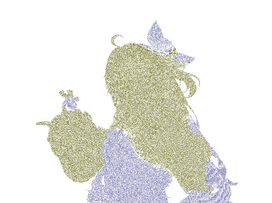

全屏 Sobel 或深度边缘检测很方便，但它只能看到屏幕上的变化，无法天然区分角色外轮廓、衣片内部折线、头发与脸的交界，以及背景中的高对比物体。对于需要稳定角色轮廓的 NPR 管线，独立几何层往往更容易控制。

会话资料中的通用思路是 inverted hull：复制一层跟随姿态的几何，沿法线或明确方向扩张，剔除前面，只让背面壳体在原模型边缘露出。

## 1. 几何轮廓与屏幕边缘各自负责什么

| 方法 | 擅长 | 不擅长 |
| --- | --- | --- |
| Inverted Hull | 稳定外轮廓、部件级宽度、材质和裁切 | 需要额外几何、处理法线和动画 |
| Depth/Normal Edge | 屏幕空间接触边、场景级边缘、无需复制网格 | 容易把内部高对比也当成轮廓 |
| Composite Color Edge | 快速风格化、低成本全屏效果 | 难以控制角色与背景的语义 |

实际方案通常组合使用：几何层负责角色主轮廓，合成器负责局部深度边缘或后期增强。

## 2. 为什么轮廓最好按部件拆开

脸、头发、衣服和附属物的轮廓需求不同：

- 脸部需要更细的宽度和透明裁切；
- 头发可能需要沿发束方向保持边界；
- 服装需要避免内层布料被统一描边；
- 毛绒层可能只需要很弱的边缘；
- 小道具需要独立颜色和深度关系。

因此保留部件级轮廓材质或 Geometry Nodes 实例，而不创建全角色统一的黑色壳体。

## 3. Blender Geometry Nodes 的最小路线

一个可回滚的轮廓节点组可以包含：

1. 输入原始网格或姿态后的网格；
2. 计算或读取变形后法线；
3. 根据部件属性选择宽度；
4. 沿法线移动顶点；
5. 反转或选择面方向；
6. 绑定独立轮廓材质；
7. 对透明区域执行裁切；
8. 输出轮廓覆盖率诊断。

宽度最好同时考虑对象缩放、相机距离和渲染分辨率。固定世界单位的扩张在远近镜头下会产生明显变化；完全固定像素宽度又可能需要额外的屏幕空间近似。

## 4. 法线和动画是关键难点

静态模型上，顶点法线通常足以做第一版；动画模型中，法线必须与姿态变形保持一致，否则轮廓会抖动、塌陷或在关节处突然变宽。

当模型存在 Weighted Normal、法线分裂或特殊切线时，应把轮廓用的法线与表面着色法线分开验证。轮廓只需要稳定的外扩方向，不一定要复用完整的表面法线逻辑。

## 5. 透明裁切不能事后补

衣片、刘海和毛绒的轮廓往往包含 alpha cutout。若先生成完整外壳，再在合成器中擦掉透明部分，深度和遮挡关系可能已经错误。应在轮廓材质阶段就读取同一张裁切输入，确保外壳和表面使用一致的可见区域。

## 6. 验证矩阵

至少要测试：

- 正面、三分之四、侧面；
- 近景、半身、远景；
- 静止姿态和关节运动；
- 左右主光；
- 透明边缘和头发交叠；
- 轮廓关闭后的表面回滚。

如果只看一张正面截图，很容易把错误的宽度、错误的法线和错误的透明排序互相抵消。几何层的优势就在于它可以单独输出一张纯色覆盖图，让问题直接可见。

描边决定哪些几何边界有资格成为角色的视觉边界。
