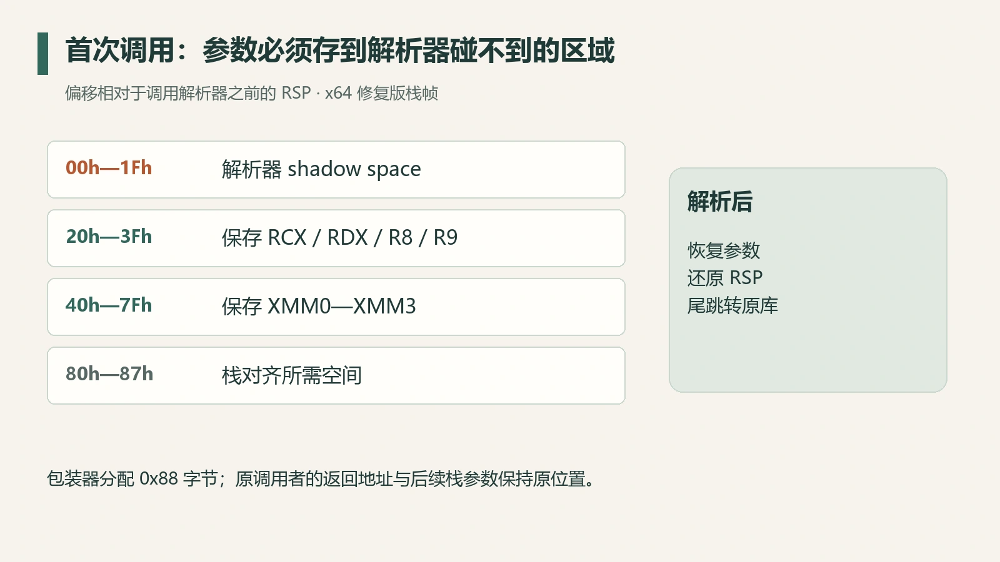
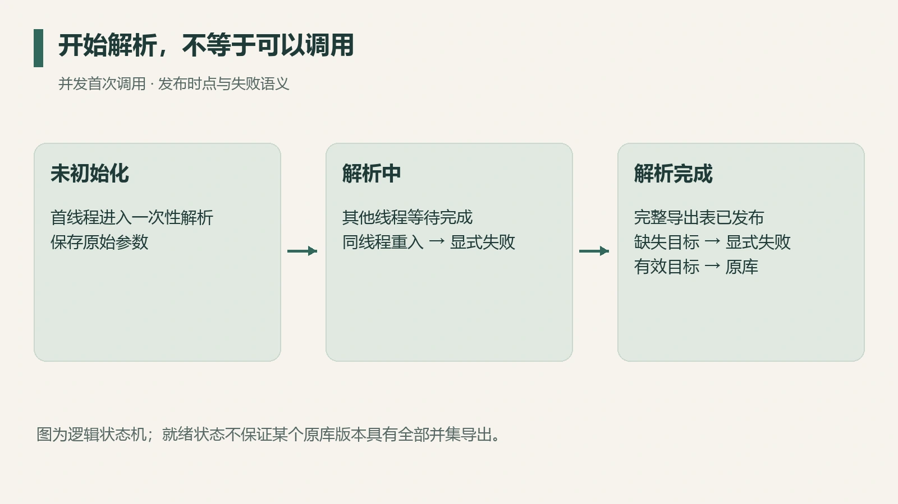

代理 DLL 成功被加载，RenderDoc 能截帧，这证明入口路径可用。但代理还承担另一件事：应用对原库的每一次调用，都应收到正确的参数和正确的行为。

这次 Aftermath 代理审查发现了两个不容易从截图看到的问题：参数保存在被调函数能够覆盖的 shadow space 内；并发首次调用又可能在原库地址尚未发布时提前返回。入口成功之后，转发正确性需要单独检查。

本文只讨论这份 x64 代理的 ABI 与初始化实现。加载入口能否适用于另一个应用，还要独立检查它的导入方式和初始化时序。

## 代理真正需要保住什么

代理给应用提供一组导出，再找到被保留的原库函数。应用看到的是代理，实际执行应继续进入原库。因此需要保住调用约定、参数寄存器、栈参数、返回路径和失败语义。

在默认 Windows x64 ABI 下，前四个参数按位置和类型使用通用寄存器或 XMM 寄存器；调用者还为被调用者预留 shadow space。寄存器会被中间函数改写，调用解析器之后需要显式恢复入口值。[微软调用约定](https://learn.microsoft.com/en-us/cpp/build/x64-calling-convention?view=msvc-170)给出了这些约束。

## 参数保存区落在 shadow space 里

旧包装器在调用日志函数前，把 `RCX/RDX/R8/R9` 写到当前栈指针的前四个槽。这块区域恰好又是它为下一次 `call` 留出的 shadow space。

审查生成对象文件后确认，日志函数实际使用了其中多个槽位，覆盖了保存的参数。日志函数本身遵守 ABI；错误在于包装器同时把这块区域当作自己的持久保存区。

*图 1：修复后包装器在调用解析器前的栈布局。偏移相对于此刻 RSP；图中只展示包装器分配的 0x88 字节区域。*

修复版给解析器保留独立的 `0x20` 字节 shadow space，把四个通用参数放在更高位置，并保存 `XMM0—XMM3`；只保整数参数覆盖不到浮点和混合签名。

恢复参数后，包装器还原栈指针，通过尾跳转进入原函数。这样原函数继续使用调用者原本的栈参数与返回地址。正式汇编还声明栈帧展开信息，避免解析原库过程中发生异常时无法正确展开。

## 标志位发布早于地址填写

另一个问题来自首次调用的发布时点。旧实现先设置已解析标志，再加载原库和填写导出地址。第二个线程看到标志后跳过初始化，却可能读到空地址，随后返回零。

这会制造一次假的 SDK 结果，而且是否出现取决于线程时序。单线程烟测或偶尔成功启动，很难覆盖它。

*图 2：逻辑状态机示意。其他线程需要等到初始化完成；同线程重入另作显式失败处理。*

修复使用一次性初始化机制，让并发首调等待同一次解析。完整填写导出表后才发布完成状态。若解析过程中发生同线程递归进入，则不能等待自己，必须进入明确的失败路径。

这里的“就绪”描述初始化完成；不同原库版本的导出集合可能不同。调用某个不存在的导出时，需要单独处理。

## 缺失导出走显式失败

修复版暴露检查过的三个原库导出名的并集，共 43 个名字。某个原库可能只包含其中一部分。返回零在一些 SDK 函数中可能被误认成成功，因此这一实现选择显式 fail-fast。

这是该代理的失败策略；已知且固定的 ABI 可以设计更具体的错误返回，泛化包装器只能猜测返回类型和错误语义。

这份代理按名字覆盖已检查的应用导入，覆盖范围不含不同版本的原始 ordinal 编号和 32-bit 库。适用条件写清之后，“导出并集”才不会被读成任意版本的完整兼容。

## 将转发测试与实机结果分开

烟测应使用能自检参数的原库替身，而不只调用一个无参数函数。至少包含：

| 检查项 | 它能暴露的问题 |
| --- | --- |
| 四个通用参数及第五个以上栈参数 | 参数槽位和栈恢复错误 |
| 浮点与混合签名 | XMM 保存遗漏、位置映射错误 |
| 多线程同时首次调用 | 地址提前发布、初始化竞争 |
| 原件和导出缺失 | 错误路径被伪装为正常返回 |
| 多种原件文件名与独立目录 | 路径依赖和原件识别错误 |

已有记录中，MSVC 与 ClangCL 完整构建及代理烟测均通过，之后用户确认了实机运行成功。两类证据各有范围：烟测检查转发契约，实机确认已测试应用中的入口与捕获行为。它们共同支撑这次修复；新应用的兼容性仍需单独验证。

模块加载通知也有自身限制，重解析、日志和改写放在回调里会引入额外风险；微软明确说明通知发生在动态链接之前。[LdrDllNotification 文档](https://learn.microsoft.com/en-us/windows/win32/devnotes/ldrdllnotification)是设计这类路径时应先核对的约束。

代理的维护价值，最终在于它怎样稳定地履行原库契约。成功截帧值得记录，参数、并发和失败路径同样值得单独验证。
