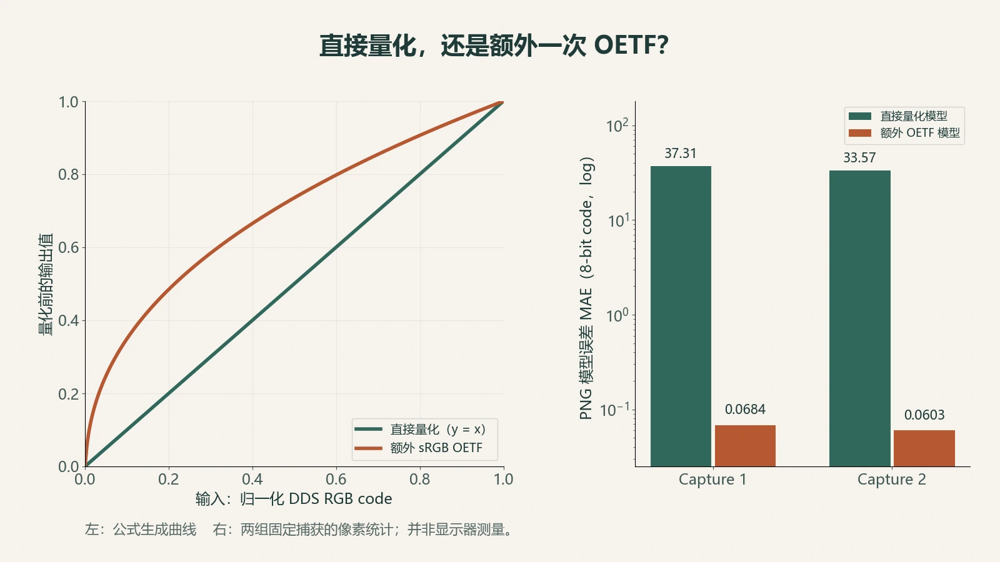
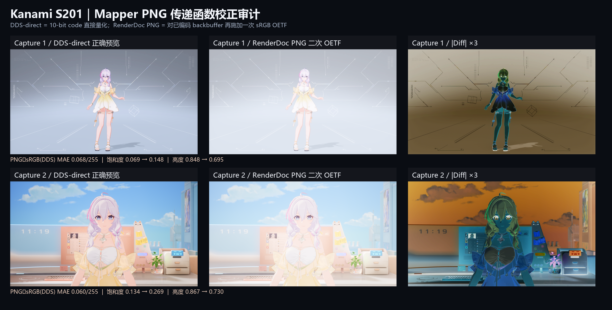

同一帧画面，游戏里颜色正常，RenderDoc 导出的 PNG 却明显偏亮、偏淡。遇到这种情况，很容易先怀疑曝光、Tone Mapping，或者透明通道与白色背景混合。

这次排查最终落到了导出环节：被导出的 Mapper 输出已经是面向显示的编码值，PNG 导出又对这些值应用了一次 sRGB OETF。额外的传递函数抬高了中间调，也改变了颜色通道之间的比例。

这个结论来自两组固定捕获的像素对照。它适用于这两组最终 Mapper 输出；线性 HDR 缓冲或其他 RenderDoc PNG 需要各自核对。

## 先排除看起来最像的原因

两组来源纹理都是 `R10G10B10A2_UNORM`，分辨率为 2560 × 1440。每个 RGB 通道有 10 bit，Alpha 有 2 bit。

原始 DDS 与对应 PNG 的 Alpha 都是全屏零。这确实会让某些查看器显示透明内容，但检查旧拼板生成过程后发现，它只是把图像转为 RGB，没有执行与白底的 Alpha 合成。Alpha 异常确实存在；这张拼板发灰的原因落在传递函数上。

还需要区分存储格式与颜色语义。`UNORM` 说明整数怎样归一化成数值；这些数值属于线性光还是显示编码，需要按阶段判断。最终输出缓冲与光照计算中的 HDR 缓冲，可以使用相似的访问方式，却处于不同的颜色阶段。

## 用两条候选路径解释 PNG

将 DDS 的 10-bit RGB code 记为 $c_{10}$。如果这些值已经完成显示编码，转换成不透明 8-bit 预览可以直接量化：

$$
c_8=\operatorname{round}\left(255\frac{c_{10}}{1023}\right).
$$

另一条候选路径是对归一化值额外应用 sRGB OETF，然后量化。这里使用标准的分段函数：

$$
f(x)=\begin{cases}
12.92x,&x\leq0.0031308,\\
1.055x^{1/2.4}-0.055,&x>0.0031308.
\end{cases}
$$

函数定义可核对 [Khronos 的 sRGB 规范说明](https://registry.khronos.org/OpenGL/extensions/EXT/EXT_texture_sRGB.txt)。在本次审计中，这条函数是待检验的数值模型；是否应该使用它，取决于输入所在的颜色阶段。



*图 1：曲线由公式生成；旁边的误差来自本次两组捕获。显示器测量不在本次范围。*

实际 PNG 与两条预测分别求平均绝对误差，结果如下。单位是 8-bit 通道 code。

| 捕获 | PNG 对直接量化 DDS 的 MAE | PNG 对额外 OETF 的 MAE | 额外 OETF 模型的最大误差 |
| --- | ---: | ---: | ---: |
| Capture 1 | 37.3066 | 0.0684 | 1 |
| Capture 2 | 33.5680 | 0.0603 | 1 |

后一种解释的平均误差小于 0.07 个 code，而且最大误差只有一个 code。相比几十个 code 的直接路径误差，这个差异足以支持“PNG 又经过一次 OETF”的判断。

## 为什么看起来像低饱和

OETF 对不同输入区间的增益不同。较暗的通道被抬升得更多，三个通道更接近，画面就容易显得偏白、偏淡。它不会简单地给所有颜色乘同一个系数。

两组图像的平均 HSV 饱和度也支持这个观察：

| 捕获 | 原 PNG | DDS 直接量化预览 |
| --- | ---: | ---: |
| Capture 1 | 0.0687 | 0.1478 |
| Capture 2 | 0.1341 | 0.2692 |

这里的 HSV 饱和度描述两条导出路径的变化；色度测量与感知质量评分另行进行。



*图 2：沿用原研究的比较图。左列是 DDS RGB code 直接量化，中列是原 PNG，右列为差分的三倍放大显示。差分色彩用于放大差异，场景颜色以中列为准。*

## 修复应放在输出语义上

本次修正采用三个步骤：从 DDS 读取 RGB code，直接量化为 8-bit，写成不透明 RGB，并嵌入标准 sRGB ICC profile。嵌入 profile 用来说明图像的显示解释方式，像素值不再编码。

下面是用于验证候选路径的最小计算。输入是同一张 DDS 解出的 RGB 数组；完整的 DDS 解析由单独工具完成。

```python
import numpy as np

def srgb_oetf(x):
    x = np.asarray(x, dtype=np.float64)
    return np.where(x <= 0.0031308,
                    12.92 * x,
                    1.055 * np.power(x, 1 / 2.4) - 0.055)

rgb = rgb10.astype(np.float64) / 1023.0
direct = np.rint(rgb * 255).astype(np.uint8)
extra_oetf = np.rint(srgb_oetf(rgb) * 255).astype(np.uint8)

def mae(a, b):
    return np.abs(a.astype(np.float64) - b.astype(np.float64)).mean()
```

复查时要保持同一资源、同一事件、同一尺寸和通道顺序。先比较数值，再看图。两张图片来自不同曝光时刻或不同阶段时，视觉差异相似也说明不了导出路径。

## 这次结果能够说明什么

两组最终 Mapper 输出的 PNG，与“对 DDS code 额外应用一次 sRGB OETF”的预测高度一致；直接量化可以去掉这次多余变换。原始显示器 ICC 与 Windows 合成状态没有保存，修正图覆盖的是像素值路径；显示器实际观感保留为未测量项。

以后再遇到“捕获图比游戏灰”，先标清输入处于线性光、Tone Mapping 后还是显示编码后，再核对保存与查看环节各自做了什么。阶段清楚之后，Alpha、曝光和传递函数才能各自排查。

相关方法见[固定条件 A/B 验证](/posts/fixed-condition-validation/)。
