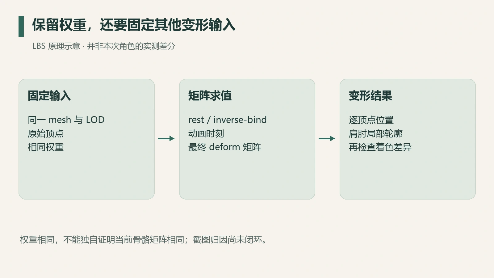
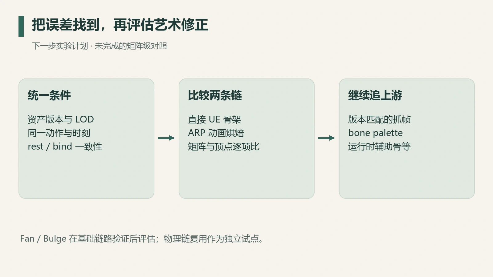

原模型进入 Blender 后，权重明明保留了，肩膀和肘部却比游戏中更容易折叠。一个很自然的解释是：游戏用了特殊的保体积算法，Blender 少了对应插件。

2026 年 9 月的定向调查找到了真实的 ACL 压缩配置、KawaiiPhysics 节点和碰撞参数，也复核了已有抓帧中的身体 VS。结果是：该 draw 的位置路径使用四影响线性矩阵蒙皮；截图差异的原因落在骨骼矩阵与输入一致性上。

这轮调查没有完成最终归因，但把下一步从“增加一个效果”收窄到了“检查变形输入是否一致”。

## 权重只是变形输入的一部分

用简化 LBS 表达一个顶点：

$$
v'(t)=\sum_i w_i\left[M_i(t)B_i^{-1}\right]v.
$$

$w_i$ 是权重，$B_i$ 表示绑定时的骨骼关系，$M_i(t)$ 表示当前时刻的骨骼变换。括号中的矩阵必须在一致的空间中计算；实际导入器还会处理对象变换和坐标约定。

即使 $v$ 与 $w_i$ 没变，只要绑定关系、最终骨骼矩阵或时间不同，$v'$ 就会不同。手掌处在相同位置时，肩胛、上臂 twist、前臂旋转和缩放仍可能不同。

*图 1：变形依赖关系示意；矩阵级比较尚未完成。*

Blender 的 Armature Modifier 提供 Preserve Volume 选项；它是明确的变形方式选择，应按 [Armature Modifier 手册](https://docs.blender.org/manual/en/4.5/modeling/modifiers/deform/armature.html)核对。“更圆”的观感属于线索；原游戏是否使用相同机制需要资产或代码证据。

## 抓帧中的位置路径怎么判定

已有身体 VS 的反汇编先用骨索引读取每骨的三行仿射矩阵，再用四个权重逐行线性混合，最后将原始顶点位置与混合矩阵作点积。

这条具体路径符合 LBS，没有看到 DQS 所需的四元数混合与归一化过程。但骨骼调色板来自上游求值：动画、helper、缩放和其他运行时处理，都可能已经体现在矩阵里。

所以“这条 VS 是 LBS”描述最终蒙皮运算；corrective 与辅助骨逻辑可能已在上游写入矩阵。字符串里存在某个类型，也需要该帧的使用证据。

## 找到插件之后，先分清它的职责

定向解包得到以下结果：

| 证据 | 已确认内容 | 与关节形变的关系 |
| --- | --- | --- |
| Engine 动画配置 | 自定义 ACL 骨骼动画压缩配置 | 负责压缩与解压，与保体积开关无关 |
| S114 战斗物理蓝图 | 10 个 KawaiiPhysics、1 个 AnimDynamics | 存在摇摆骨配置；身体关节蒙皮方式另行核对 |
| S114 Lobby 物理蓝图 | 18 个 KawaiiPhysics | 提供链根、碰撞体与参数；与战斗配置分开统计 |
| 已有身体抓帧 VS | 四影响线性矩阵蒙皮 | 支持该 draw 的 LBS 判定 |

[ACL 项目](https://github.com/nfrechette/acl-ue4-plugin)的职责是动画压缩，[KawaiiPhysics](https://github.com/pafuhana1213/KawaiiPhysics)则用于简化的骨骼物理。发现插件内容，首先应恢复它所负责的数据流。

这次还找到了链根、阻尼、刚度、局部碰撞偏移和六条参数曲线。它们对复用头发、裙摆等物理配置很有价值；不同求解器的参数需要各自标定，资产默认值与运行时值分开记录。

## 当前 Blender 链路还有哪些变量

现有工作流经过 ARP 的 `PRESERVE + ANIM_BAKE`。这保留原权重，同时涉及重映射、动画采样和骨骼基的解释。代码中出现这些选项，属于调查线索；ARP 与误差的关系仍待对照。

动画时刻也是一个独立变量。导入 EnterAction 并放在 frame 0，未必对应抓帧中实际的 Idle、过渡混合或物理状态。LOD、资产版本和静置矩阵也需要逐项一致。

此外，阴影、法线和高光会改变体积的视觉判断。只有先在相同姿态下检查轮廓或实际顶点，才能分离着色差异与几何差异。

## 下一步的最小对照

*图 2：下一步实验顺序。此图表达待执行的对照，误差来源尚未查明。*

首先固定同一 mesh、LOD 和动画时刻，用直接 UE 骨架与 ARP 烘焙结果比较：权重、rest/inverse-bind、deform bone 的求值矩阵，再到肩肘局部顶点位置。

如果这一步已经出现差异，先查轴、twist、映射与采样；如果两条 Blender 路径一致，再把它们与版本匹配的抓帧 bone palette 对齐，调查运行时上游。

Joint Fan 或 Bulge 可以是有效的艺术修正，评估顺序放在基础矩阵链路核对之后；先补效果会把坐标错误暂时遮住，换一个动作又重新暴露。

这轮调查的停止点很明确：身体 VS 的蒙皮方式与可复用物理配置已有文件证据，截图形变差异的原因仍待闭环。下一轮的对象是同条件矩阵与顶点比较，插件名称只作为线索。
