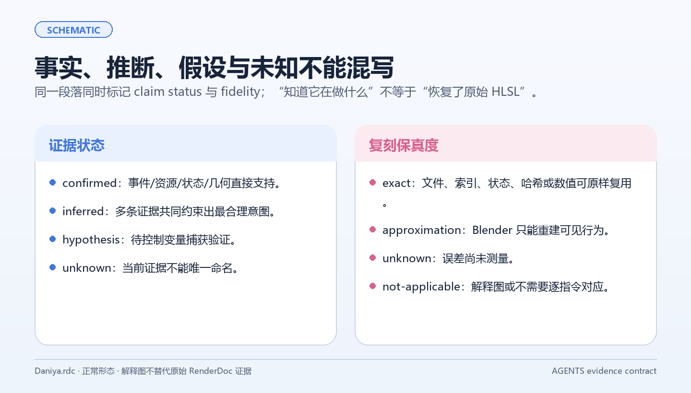

图形学研究最危险的时刻，是已经有了一张好看的结果图，却还没有足够证据解释它。此时很容易把常见行业做法、文件名和视觉直觉拼成一个“看起来合理”的 Shader。

严格回退让工作继续推进时仍然知道自己站在哪里：哪些是事实，哪些是候选，哪些只适合放进诊断模式。

## 1. 两条轴：证据等级与复刻保真度

分别记录：

### 证据状态

- Confirmed：身份、绑定和数据流形成闭环；
- Strong：多个独立证据一致，但仍需固定条件校准；
- Probable：候选解释合理，只能进入 Profile 或 Diagnostic；
- Approximation：可见行为可以近似，但不是内部等价；
- Unknown：当前无法唯一命名；
- NotApplicable：目标后端没有对应能力。

### 复刻保真度

- Exact：输入、状态和输出可以在当前范围内原样复用；
- Approximation：重建可见行为或视觉趋势；
- Unresolved：缺少足够数据，暂不连接生产输出。

证据强度与重建保真度是两个独立维度：证据很强可以对应 approximation，节点存在也可以对应 unresolved。两套标签同时保留。

## 2. 每个 Surface Family 单独决策

不要先给整个角色贴一个 Recovered 标签。Face、Eye、Hair、Cloth 和 Outline 可能处在不同证据等级：

~~~text
身份 + 绑定 + 数据流闭合？
       ├─ 是 → Recovered candidate
       └─ 否 → Strict Fallback
                     ├─ Baseline
                     ├─ Approximate
                     └─ Diagnostic
~~~

这能防止一张脸部的强证据覆盖头发或布料的未知项，也能让后续实验精准地指向一个模块。

## 3. Unknown 的保存方式

Unknown 不是空值，也不是艺术默认值。可保留：

- 原始值及其来源；
- 角色、通道和色彩空间；
- 可能的坐标空间；
- 候选语义及其证据；
- 目标节点或明确的 unbound/metadata-only/diagnostic-only 状态；
- 已知限制和下一次验证条件。

一个数值可以已知，但它的业务意义仍然 Unknown。中性默认值只能作为可编辑 fallback，不能提升证据等级。

## 4. 不同证据允许做什么

| 状态 | 可以做 | 不可以做 |
| --- | --- | --- |
| Confirmed | 进入共享模块或生产输出 | 推广到未经验证的角色 |
| Strong | 进入 Profile 并参加固定条件 A/B | 直接称为全局规则 |
| Probable | 进入候选、诊断和实验 | 写成确定的业务名称 |
| Approximation | 进入近似模式并标注损失 | 伪装成原始内部逻辑 |
| Unknown | 保留原值、记录、显示诊断 | 静默丢弃或强行接线 |

这套规则减少“确定答案”，但换来工具和项目本身更可靠。

## 5. 何时可以把候选升级

至少需要：

1. 在多个独立材质或角色区域中出现同样关系；
2. 在两个以上视角或光照条件下保持；
3. 通过单变量扰动影响到预期的中间输出；
4. 有替代解释被排除；
5. Blender 实现能独立开关、回滚和重现。

单张截图中的空间相关性只能支持候选，不能完成升级。

## 6. 一个实用的 fallback 算法

~~~text
inventory all inputs
for each input:
    preserve raw value and provenance
    map only direct facts to semantic sockets
    expose candidates in Diagnostic
    leave unresolved inputs unbound
build Baseline and Approximate variants
run fixed-condition A/B
promote only when the evidence contract closes
~~~

严格回退的最终产物是一个带有边界说明、诊断口和下一次实验任务书的可运行候选，而非空白材质。
