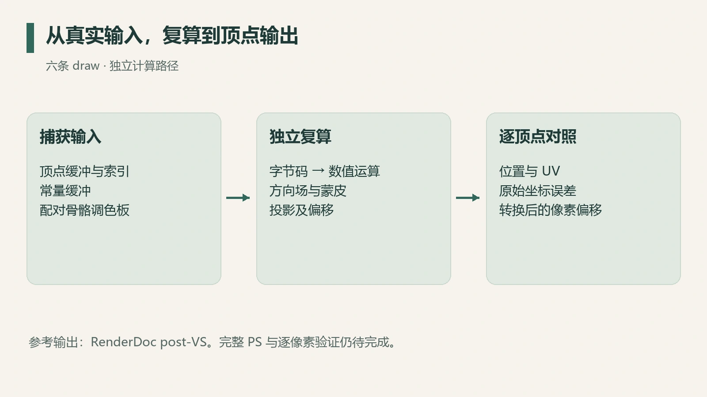
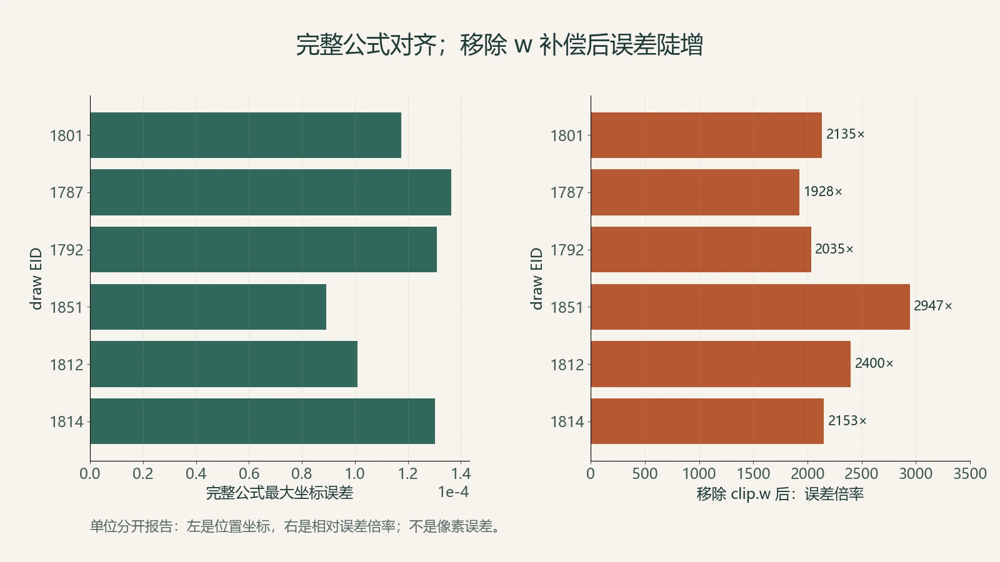

看到角色网格被重新绘制，很容易把它归类为反壳描边：顶点沿法线向外移动，再通过剔除留下轮廓。但这次捕获中的细线主要出现在头发折缝和身体内部，背景上的变化反而很少。

要解释这个现象，单靠最终截图不够。需要从字节码取出展开方向，再把公式代入真实顶点、常量缓冲和骨骼调色板，检查它能否复算出 RenderDoc 的 post-VS。

2026 年 9 月的独立复核覆盖六条描边 draw。结果支持两个具体判断：展开方向来自顶点属性中的方向场；在本次采样区间内，未被屏蔽的顶点偏移为一像素。

## 先确认它画了哪些几何

材质遍、线稿遍和速度遍重复绘制同一批 section。头发、身体、脸、裙子等部件的索引数分别一致，这是几何关联的线索；骨骼调色板的资源身份又提供了第二层核对。

线稿组缺少独立调色板快照时，复核按资源 ID 找到材质遍中对应的快照。两次事件间的动作列表没有列出缓冲写入，使用配对快照复算又能对齐 post-VS。这两条证据共同支持复用，结论仍只覆盖这些 draw 实际访问的输入。



*图 1：验证路径示意。重写公式与参考 post-VS 采用不同的计算来源，避免只检验自己的实现。*

## 展开方向藏在顶点色里

其中两种 VS 将顶点色 RGB 解码为方向：

```hlsl
float3 d = normalize(vertexColor.xyz * 2.0 - 1.0);
```

另一种变体还组合了额外顶点属性，上述一行只对应其中一种 VS。解码后的方向经过骨骼混合、空间变换和投影，成为屏幕上的二维方向。

输入值也有数值支持：`|2c−1|` 的中位数为 1.0000，最小值约为 0.9877，与量化存储的单位方向相符。顶点色在这里承担几何控制信息，最终可见颜色另行输出。

这就解释了“为何朝内出现细线”：决定偏移的是这套方向属性，网格法线不参与这一步。同样一块几何重画一次，展开可以指向折缝内部。具体方向来自数据，名称按数据来源确定。

## 一像素偏移怎样抵消透视

把展开前的裁剪位置记为 $p$，其第四分量为 $w$，屏幕单位方向为 $u$，目标偏移为 $q$ 像素。用宽高 $W,H$ 写出简化的水平、垂直偏移：

$$
p'_{xy}=p_{xy}+2wq\left(\frac{u_x}{W},\frac{u_y}{H}\right),\qquad p'_w=p_w.
$$

透视除法后，额外乘上的 $w$ 被约掉；NDC 到像素又有半个屏幕尺寸的缩放，因此最终位移长度为 $q$。垂直轴符号需要按实际视口约定处理。

六条 draw 中，非零偏移顶点的长度均值都为 **1.000000 px**，记录精度下的标准差为 **0.00000**，采样 $w$ 范围合计约为 157—204。这描述顶点屏幕偏移；光栅化后每条可见线的像素覆盖需要另行测量。

## 把公式逐项拆掉，才知道谁真正生效

完整公式对 post-VS 的最大坐标误差约为 $8.92\times10^{-5}$ 至 $1.36\times10^{-4}$，坐标量级约 320。这个误差量级与 float32 运算顺序差异相容，但本次没有进行逐指令 ULP 等价证明。



*图 2：来自独立复核表。左侧为原始坐标误差，右侧为删去裁剪空间乘 w 后的误差倍率；两侧单位不同。*

最有信息量的对照如下：

| 移除或改变的项 | 六条 draw 的结果 | 能支持的解释 |
| --- | --- | --- |
| 偏移乘 `clip.w` | 误差增加约 1900—2900 倍 | 恒定屏幕偏移依赖这一步 |
| 末段系数 2 | 误差增加约 970—1480 倍 | NDC 与像素尺度必须匹配 |
| 距离项 | 当前样本误差不变 | 当前输入落在距离项的恒值区 |
| `round_pi` | 一条 draw 明显变化，其余不变 | 小数宽度在该 draw 中被向上取整 |

还有一个容易漏掉的资源细节：某条采样指令带通道重排，最终读取的是纹理原始红通道。直接按目标寄存器分量名字猜成 Alpha，会使掩码失效，误差上升约三个数量级。

## 距离项存在，却没有解释当前的等宽

从本次常量代入公式，距离因子在 $w\approx1031$ 前保持 1，之后下降，在 $w\approx1473$ 归零。再经过向上取整，正的小数宽度仍可能变成一像素。

这些远距离阈值来自公式外推。捕获只覆盖 157—204，没有远段的实测样本。因此可以解释当前等宽来自 `clip.w`，也可以描述该组常量的外推行为；远端截断仍属于预测。

本研究完成的是线稿 VS 的数值验证。23 条 Shader 的语义重写已有材料，完整 GPU 宿主及逐像素 PS 对照仍待实现。把顶点输出对齐、像素输出对齐和最终画面相似分开，下一步的补证层次随之明确。

相关讨论见[几何描边与屏幕空间边缘](/posts/outline-as-geometry/)。
