基于 RenderDoc 捕获逆向分析，关注到一个容易被终帧掩盖的问题：角色不同局部怎样把信息写进延迟缓冲，GPU 在后面的全屏阶段怎样决定某个像素该交给哪套解释规则。

材料：D3D12 RenderDoc 捕获、多帧交叉验证、离线解包的同一角色模型与材质实例，以及RDC离线回放导出。

核心发现为：

:::important[核心结论]
局部材质族负责写入角色 payload，Stencil 决定像素交给哪个光照分支，Shading ID 决定角色分支内部如何解释普通表面与轮廓。
:::


## 0. 三个反常现象

先看捕获里的终帧。ROI 1 是脸与刘海交界，ROI 2 是主体头发和侧边辫子，ROI 3 是白色衣片与背景交界，分别对应后文三个重点：局部遮蔽、方向性头发响应、稳定的角色轮廓。

**页首图 F0-1** 只添加三个固定坐标细框和编号。支持的结论：角色确实同时呈现脸—刘海交互、头发各向控制和外轮廓。

从简单直觉上出发可能出错。脸部明暗像一张连续插画，捕获里刘海的完整索引范围被画了三次；头发高光看着像普通贴图颜色，同时绑着 HM、HN 和只有四行的 HR；轮廓看着像后处理描边，实际重新绘制了多个原始 section，还写了另一种 Shading ID 回角色 GBuffer。

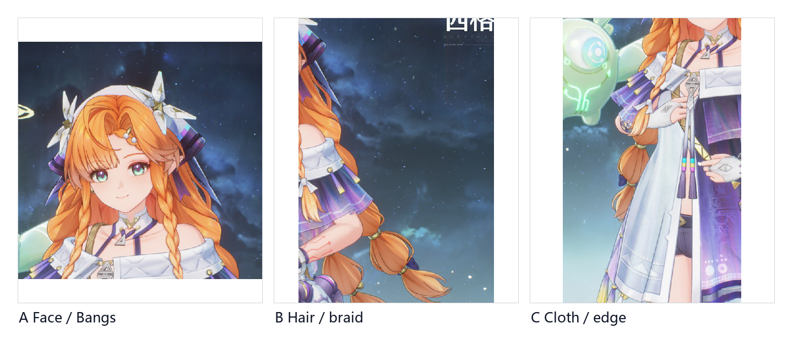

**图 F0-2（RAW）**。来源：同一 `frame72751-thumbnail.png`；处理：三个固定裁剪、相同显示变换和 Lanczos 排版缩放

这三个异常归结为三个问题。

第一，为什么 Bangs 的 `firstIndex=0`、`indexCount=29307` 在 EID 541、560、582 被原样重放三次？如果只是普通透明层叠，三次的深度写、颜色写掩码和 Stencil 条件应该差不多——实际上三者完全不同。

第二，为什么标准 Deferred pass 和 Kuro Toon pass 对着同一个 Stencil bit 做了完全相反的 Equal 测试？从命令顺序看，前者先、后者后，但这个先后到底意味着同一个角色像素被两套光照各算了一遍，还是它们处理的压根不是同一批像素——只能由像素集合回答，不能由事件名回答。

第三，为什么反壳几何还要写角色 GBuffer，还用 ID 13 跟正常表面的 ID 12 区别开？如果轮廓只是终帧上的一圈颜色，最简单的做法是叠到 SceneColor 上。它偏不，它让轮廓继续服从角色协议。

三个问题指向同一结论：开发者没把角色外观封在一个巨型材质里，而是拆成了三层——局部 payload 生产数据，路由状态决定谁拿到这批数据，全局解释器再决定怎么画。下面从几何身份开始。

## 1. 从 239 个 action 中确认谁在画

RenderDoc 里一个 draw 出现在角色附近，不等于它就属于角色。事件名可能为空，调试标签可能由引擎批量生成，JSON 里的 `role` 和 `intent` 也是解释字段。可靠的身份需要闭合到模型 section：

```text
UModel section
→ face_count × 3
→ first index
→ runtime indexed draw
→ PSO / shader family
→ 第二帧同签名复现
```

离线模型 LOD0 有七个具名材质 section。三角网格 `face_count × 3` 必须等于 indexed draw 的 `indexCount`，且 `firstIndex` 同时一致。这要求 draw 恰好读取同一段索引缓冲。自动校验结果见 [`section-mapping.csv`](/research/wuwa-xigelika-rendering-protocol/section-mapping.csv)，七个 section 与十七个表面/辅助/轮廓 draw 全部通过。

| Section | faces | indexCount | firstIndex | 主表面或关键事件 |
|---|---:|---:|---:|---|
| Bangs | 9,769 | 29,307 | 0 | 541 / 560 / 582，轮廓 642 |
| Hair | 18,419 | 55,257 | 29,307 | 571，轮廓 631 |
| Face | 4,434 | 13,302 | 84,564 | 432 / 530，轮廓 653 |
| Up | 32,810 | 98,430 | 97,866 | 503，轮廓 599 |
| Down | 24,210 | 72,630 | 196,296 | 421，轮廓 608 |
| Cloth | 14,457 | 43,371 | 268,926 | 443，轮廓 619 |
| Eye | 496 | 1,488 | 312,297 | 463 / 519 |

拿 Bangs 为例。离线 section 记录 9,769 个三角面：

```text
9,769 faces × 3 indices/face = 29,307 indices
```

运行时 EID 541、560、582 和 642 全部为 `indexCount=29307`、`firstIndex=0`、`baseVertex=0`、单实例。索引数相同只是一条线索；起点、基顶点、实例数和 section 顺序全部对上，才能确定它们重放的是同一完整索引范围。再叠加 541 与 560/582 完全不同的 RT write mask、Depth/Stencil 状态和 PS 指纹，重复提交就变成了需要解释的多 pass 机制。

Face 是第二个例子，也说明了 `firstIndex` 不可省略。Bangs 的 29,307 加 Hair 的 55,257：

```text
29,307 + 55,257 = 84,564
```

恰好等于 Face 的 `firstIndex`。Face 自身 4,434 个面给出 `4,434×3=13,302`，下一个 Up 从 `84,564+13,302=97,866` 开始。即使帧里碰巧有另一个 draw 也用了 13,302 个索引，只要起点不是 84,564，就绝非这段 Face section。这个累积边界把数量相近升级成了读取同一索引缓冲区间。

第二帧验证的是整体平移之后能否闭合：

| 职责样本 | 主帧 EID | 验证帧 EID | offset | 复核字段 |
|---|---:|---:|---:|---|
| Down surface | 421 | 740 | +319 | index range、PSO、shader |
| Bangs control | 541 | 860 | +319 | 完整区间、RT1.B-only、Depth/Stencil |
| Bangs branch A | 560 | 879 | +319 | 完整区间、NotEqual predicate、PS |
| Bangs branch B | 582 | 901 | +319 | 完整区间、Equal predicate、PS |
| Up outline | 599 | 918 | +319 | 原区间、Front Cull、ID 13 |

所有配对事件均为固定 `+319`。把 EID 当永久身份，插入一个调试事件就全乱了；用几何区间、固定状态、shader 指纹和相对顺序的组合，事件整体移动后仍可重新定位。后文保留 EID 仅为方便回捕获复查。

常见的错误识别方式：

| 容易走错的识别方式 | 缺陷 | 本文采用的约束 |
|---|---|---|
| 只看终帧位置 | 角色前后的透明物、特效也会覆盖同一屏幕区域 | 先匹配 section index range |
| 只看 action 名或 `role` | 标签可能为空或来自分析者解释 | 读取 draw、PSO、reflection 原始字段 |
| 只看 indexCount | 不同索引段可能长度相同 | 同时要求 firstIndex/baseVertex/instance |
| 记住单帧 EID | 帧间事件插入会使号码漂移 | 用第二帧签名与相对顺序复现 |

Bangs 排在索引缓冲开头，`firstIndex=0`；541、560、582 三次都用了完整的 29,307 个索引。Face 和 Eye 各自出现一次正常表面绘制和一次关闭颜色写入的 Stencil writer。轮廓阶段再次用了 Up、Down、Cloth、Hair、Bangs、Face 的原始区间，反壳就是原几何换了渲染方式。

第二帧两帧角色姿态和背景动画都变了，不能直接拿两张终帧做 pass 差分；但只要 section 区间、相对顺序、固定管线指纹和 shader 家族跨帧复现，这条角色链就能从 239 个 action 中挑出来。

这种身份闭合将事实和命名分开了。`Bangs` 作为 section 名来自离线模型，刘海控制写入只是对 EID 541 行为的工作性描述。如果后面像素差分否定了只发生在脸部的直觉，后者修改，前者不变。

## 2. BasePass 写入角色 payload

确认 section 之后，七个材质实例分属三个家族：

- `MSM_ToonCommon`：Up、Down、Cloth；
- `MSM_ToonHair`：Hair、Bangs；
- `MSM_ToonFace`：Face、Eye。

下面这张图把每个家族的原始像素输入并排放置，不画箭头流程。ToonCommon 代表项同时有 D、FTM、N、RGID；ToonHair 除基础输入外有 HM/HN/HR；ToonFace 的 Face 与 Eye 使用完全不同的图像构图，但进入同一家族。

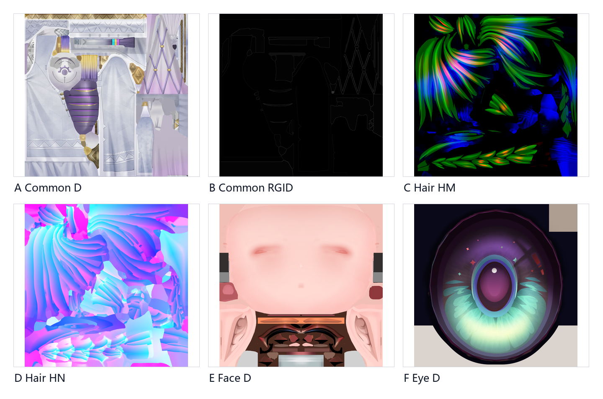

**图 F2-1（RAW）**。来源：`../fig/raw/source/textures/` 中的 Down_D、Down_RGID、Bangs_HM、Bangs_HN、Face_D、Eye_D；处理：逐字节副本与共享显示缩放，不做语义着色；支持的主张：三个材质族获得不同形态的局部输入；不支持或尚未证明：材质实例配置某输入、运行时声明某输入、该输入对当前像素产生可见贡献，是三个不同命题，图中不能把它们合并。

BasePass 表面 draw 的共同点：写角色 MRT payload、写入角色相关 Stencil、正常表面的 Shading ID 统一设为 12。payload 包括法线、颜色、材质参数和离散 ID，供后续阶段解释使用，并非终帧里已经完成的肤色、头发高光或环境反射。Kuro Toon 的全屏 resolve 在更后面出现，读取 GBuffer 和其他场景输入，再决定怎样形成 SceneColor。

这套架构把局部数据生产和全局光照解释彻底分开了。Up、Down、Cloth 共享 ToonCommon 的写入合同，靠 RGID 和参数组保留局部美术控制；Hair、Bangs 共享 HM/HN/HR 型输入，Bangs 额外多出脸域交互；Face、Eye 针对表情、阈值、视差和高光构图组织参数，但仍把像素送进统一角色路由。

材质实例 JSON 不能当作当前帧的逐像素执行记录。实例中有某个开关，仅说明配置存在；shader reflection 声明了某张纹理，仅说明当前变体可访问它；证明它确实影响了这个像素，还需要 shader debug、受控置零或可配准的输出差分。[`material-matrix.json`](/research/wuwa-xigelika-rendering-protocol/material-matrix.json) 给每个材质保留了 `configuration_proves_current_frame_contribution=false`。

三个证据层级各对应不同的开发问题。配置层回答美术能调什么，reflection 层回答编译变体可能读到什么，像素层回答这次 draw 的某个输出是否确实随输入变化。一张贴图可能因静态开关完全未进变体，也可能被声明绑定但在某分支中从未采样，还可能被采样后乘以零权重。仅把 MI 名单和终帧并排，无法区分这些情况。本文把参数表作为候选接口，运行时资源身份作为绑定证据，再用通道统计、相邻事件差分或受控消融决定是否升级主张。

集中式 resolve 的团队协作模式：资产作者在三个材质族内部迭代局部编码，渲染程序员维护统一的角色光照入口，双方通过 payload、Stencil 和 Shading ID 协作。代价是合同若无文档，某个看起来空闲的通道或 bit 可能被另一模块悄悄依赖。逆向的顺序是先恢复合同、再推测公式。

运行时纹理匹配提供了另一层检查。19 个可比较资源里，分类保持为 `3 pixel-exact / 8 near-identical decoded / 8 unresolved`。pixel-exact 就是解码后像素一模一样；near-identical decoded 允许压缩和解码带来的极小差异；unresolved 就是现有指标还不够认领本地资产。Face_D 和 Eye_D 属于第二类，不应该往上升级。

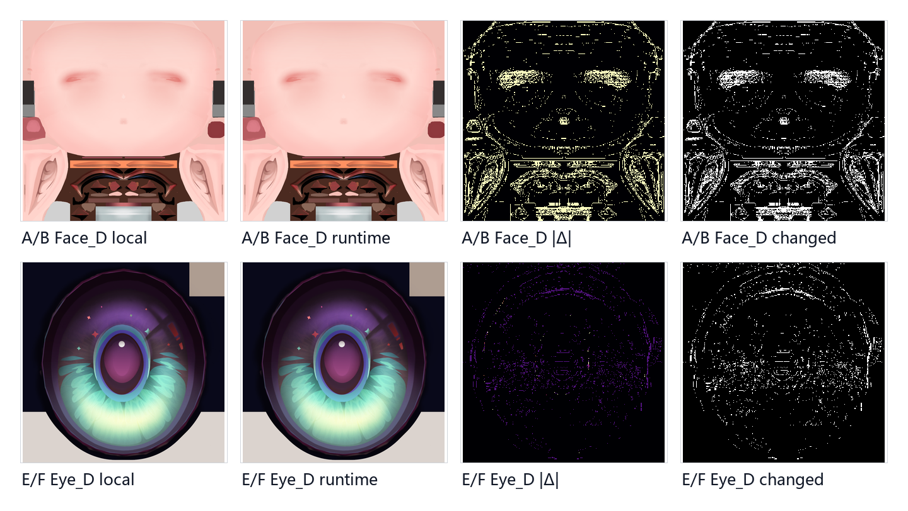

**图 F2-2（DERIVED）**。来源：本地 Face_D/Eye_D 与 EID 432 `ResourceId::1448252`、EID 463 `ResourceId::1448511` 的 runtime preview；处理：相同尺寸、精确对齐、UNORM 字节绝对差，差分共享非零值的 p99.5 显示上限；支持的主张：两组是 near-identical decoded，而非解码后零误差；不支持或尚未证明：比较没有证明磁盘文件、GPU 压缩块或原始容器字节一致。

第一层协议的可复现表述：七个 section 由三个 shader 家族写入不同局部 payload，但所有正常表面都携带角色路由所需的状态和 ID 12。接下来回答 Face、Eye 和 Bangs 为什么需要在共同合同上再加两位 Stencil 语义。

## 3. 两位 Stencil 与三次 Bangs 绘制

这是整条链里容易被事件名误导、也适合用像素证据纠错的部分。三个 Bangs draw 的对比：

| EID | geometry | depth | stencil compare | pass op | color write | texture declarations |
|---:|---|---|---|---|---|---:|
| 541 | 29,307 indices，first 0 | GreaterEqual，test on，write off | Equal，ref `0x02`，mask `0x1A` | Keep | 仅 RT1.B，mask `0x04` | 0 |
| 560 | 同一完整区间 | GreaterEqual，test/write on | NotEqual，ref `0x06`，mask `0x1E` | Replace | 常规角色 MRT | 7 |
| 582 | 同一完整区间 | GreaterEqual，test/write on | Equal，ref `0x06`，mask `0x04` | Keep | 常规角色 MRT | 7 |

三次 draw 不是简单过绘制。541 不写深度，只开一个颜色通道，完全不声明 Texture2D；560 和 582 写正常角色 payload，却用不同 compare mask 选择像素。把它们压缩成刘海画了三遍，恰好丢掉了开发者真正建立的协议。

### 3.1 Stencil 的 canonical 值

先看离线回放导出的实际 Stencil。图中橙色是值 2，蓝色是值 6，灰色是捕获中仍存在的 128，暂不指定业务含义。503 之后角色主体已大面积写入 2；519 和 530 的 Eye/Face writer 逐步引入 6；541 用 Keep，值不变；560 的 Replace 把通过自身分支的像素写回正常角色形态；582 也是 Keep。

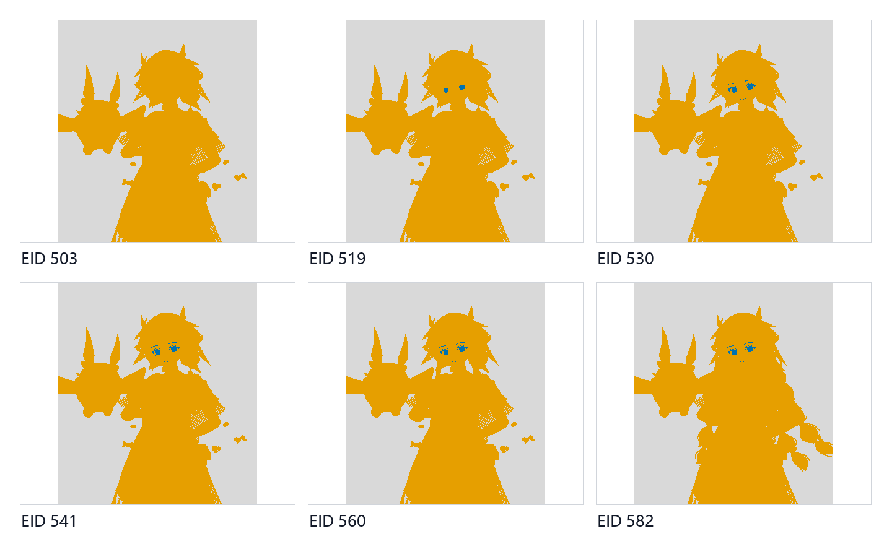

**图 F3-1（RAW/DERIVED DISPLAY）**。来源：EID 503、519、530、541、560、582 后同一 D32S8 资源的 Stencil aspect；处理：固定裁剪、离散值映射和 nearest-neighbor 缩放，未根据画面手绘 mask；支持的主张：捕获帧内确实出现 2、6、128，Face/Eye writer 引入 6，而 541 不改变 Stencil；不支持或尚未证明：值 128 的业务意义，以及只凭颜色外形给任何值命名。

正文始终说 canonical 2/6，而非 Reference 会把整个字节强制写成 2 或 6，原因是 D3D 的 Replace 受 write mask 约束：

```text
NewStencil = (OldStencil & ~WriteMask) | (Reference & WriteMask)
```

正常角色 BasePass 用的是 `reference=0x02`、`writeMask=0xFA`：

```text
New = (Old & 0x05) | 0x02
```

`0xFA` 没有覆盖 bit0 和 bit2，所以这两个位会从旧值保留下来。如果旧值在这些位上为零，结果就是 2；如果 bit0 原先是一，结果就是 3；如果 bit2 也有旧状态，结果还可能不是最简单的那个字母。Face/Eye writer 用的是 `reference=0x06`、`writeMask=0xFE`：

```text
New = (Old & 0x01) | 0x06
```

这里保留了 bit0，并写入 `0x02|0x04`，所以清零前提下得到 6，bit0 保留时得到 7。EID 560 虽然 Reference 是 6，却配了 `writeMask=0xFA`，代进去一看还是：

```text
New = (Old & 0x05) | 0x02
```

560 的 compare 在找一个分区，Replace 把通过后的像素重新收敛回正常角色的 `0x02` 相关状态。541 和 582 的 pass operation 都是 Keep，它们不会因为 write mask 非零就自动改值。Reference、compare 和写入是三件不同的事，不能看到一个十六进制数就当成整字节赋值。

### 3.2 541 的 Stencil 条件

EID 541 的实际判定是：

```text
(S & 0x1A) == (0x02 & 0x1A)
```

而：

```text
0x1A = 0001 1010
```

mask 包含了 `0x02`、`0x08`、`0x10`，但不包含 `0x04`。所以：

```text
0x02 & 0x1A = 0x02
0x06 & 0x1A = 0x02
```

canonical 2 和 6 都能通过，3 和 7 也是。这一事实直接排除了 compare mask 本身把 541 限定到 Face/Eye 状态的解释。541 在 Face/Eye writer 之后、两个 Bangs 表面分支之前，用完整 Bangs 几何、关深度写、Stencil Keep、无纹理声明，只写 RT1.B，这是一次控制量写入，具体语义需要看实际像素。

离线回放导出同一 RT1 在 EID 530 和 541 之后的结果。仅 B 通道变化，R/G/A 变化像素数为零。固定裁剪中有 46,612 个 B 像素变化，变化后值统一落到 127，变化前在 128 到 255 之间。变化包围脸上方刘海，也延伸到两侧发束和身体边缘可见区，覆盖范围来自完整 Bangs 几何投影。

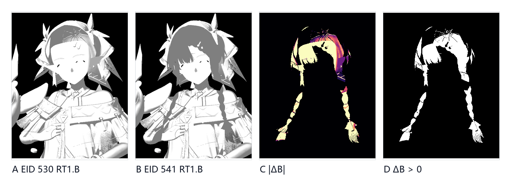

**图 F3-2（DERIVED FROM RAW）**。来源：同一 `ResourceId::1430951`，EID 530 与 541 后的 RT1.B；处理：完全对齐的固定裁剪、UNORM 线性绝对差、非零差分 p99.5 共享上限与二值变化图；支持的主张：541 在完整 Bangs 投影覆盖的可见像素上把 RT1.B 改成近似 0.498 的常量，且只改变 B；不支持或尚未证明：该通道最终被哪个 shader 怎样消费，或是否应命名为刘海阴影。Claim：`C-STENCIL-541-RT1B-FACT` 与 `C-STENCIL-541-SEMANTIC`。

固定管线确认写了什么通道、在什么几何和深度条件下写；像素差分确认实际覆盖了哪里、数值怎样变化。但二者加起来仍不足以确认下游把它当成什么。后续 shader 若把 RT1.B 当遮蔽权重，可能影响脸部；若当通用角色控制位，也可能用于其他合成。最小闭环实验是追踪 RT1.B 的第一个读者，在固定帧中把该通道钳制为原值、0、1 三档，观察哪个输出阶段先变化。该实验尚未执行，标为 P0。

### 3.3 560 与 582：canonical 分区成立，全 8 位空间却有重叠

两个表面分支的条件是：

```text
EID 560: (S & 0x1E) != 0x06
EID 582: (S & 0x04) == 0x04
```

注意它们的 compare mask 不一样，所以不能看到 Equal/NotEqual 就说是全局补集。脚本枚举 `S=0..255`，结果挺有意思：

- 541 通过 32 个值；
- 560 通过 240 个值；
- 582 通过 128 个值；
- 560 与 582 同时通过 112 个值；
- 二者并集为全部 256 个值。

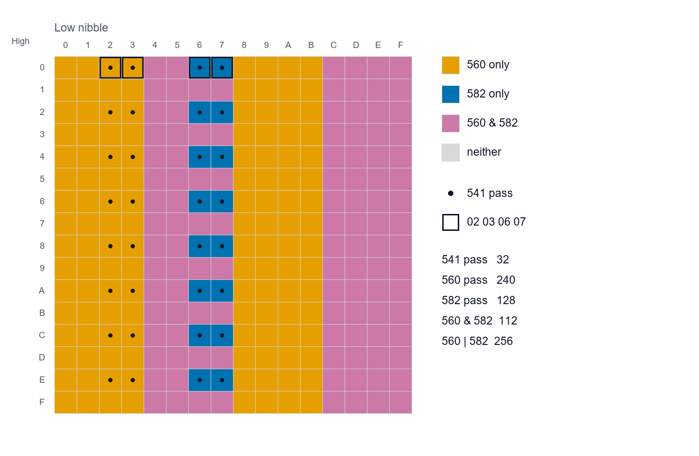

**图 F3-D1（DERIVED NUMERIC）**。来源：`../../source-report/data/basepass-pipeline-state.json` 中 541/560/582 的 compare function、reference 与 mask；处理：枚举 256 个字节并按 560-only、582-only、overlap、neither 离散着色；支持的主张：完整空间存在 112 个双命中状态，二者并集为 256；不支持或尚未证明：这是 PSO 状态空间，不是捕获画面中的像素覆盖。Claim：`C-STENCIL-560-582`。

看图时需区分协议允许的字母和所有理论字节。引擎前面的 writer 把角色像素约束到少量 canonical 状态；在这些状态中，分区清晰：

| S | EID 541 | EID 560 | EID 582 | 工作性描述 |
|---:|:---:|:---:|:---:|---|
| `0x02` | pass | pass | fail | normal-role canonical |
| `0x03` | pass | pass | fail | 保留 bit0 的 normal-role |
| `0x06` | pass | fail | pass | face/eye-role canonical |
| `0x07` | pass | fail | pass | 保留 bit0 的 face/eye-role |

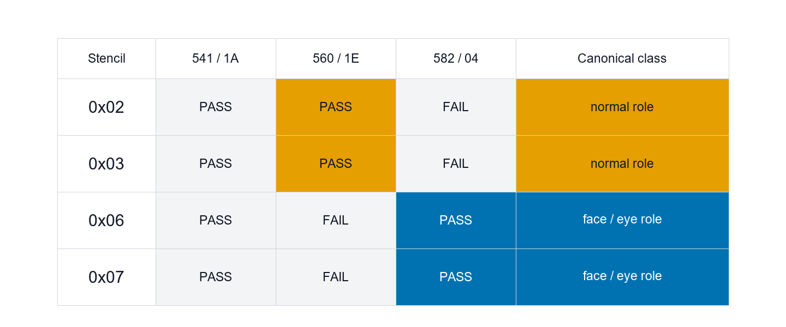

**图 F3-D2（DERIVED NUMERIC）**。来源：同一 PSO 数值与 [`stencil-truth-table-256.csv`](/research/wuwa-xigelika-rendering-protocol/stencil-truth-table-256.csv)；处理：从完整枚举中只取 2、3、6、7，展示 pass/fail；支持的主张：在协议常用状态上，560 与 582 形成 normal-role / face-eye-role 的有效分区，541 对四者都通过；不支持或尚未证明：四个 canonical 值不能替代完整字节空间，也不能证明帧内只出现这四个值。

状态机可通过 writer 约束输入字母，让两个本来有交叠的谓词在可达子集上表现为选择分支；但若将来另一个 pass 保留或设置了 `0x08/0x10`，同一套谓词组合可能进入双命中区。开发者用少量 bit 换来了跨材质路由，同时引入了一个维护约束：新增 Stencil 用途时必须检查已有的 compare mask，不能只检查 Reference。

### 3.4 两个 Bangs 分支的验证

PSO 真值表只能说明哪些 Stencil 值会通过，不能把逻辑集合贴到角色上冒充真实 coverage。有了离线导出的相邻 attachment，就可以计算事件区间之后哪些 MRT 像素值确实发生了变化。EID 560 用 541 作前基线；EID 582 必须用 571 作前基线——Hair draw 夹在 560 和 582 之间，直接用 560 会把 Hair 对 MRT 的贡献错误归到后面那个 Bangs 分支。

计算对每个可读 MRT 做逐字节绝对差，再把任一通道发生变化的像素取并集。560 区间有 64,095 个变化像素，形成完整可见刘海/头发前部轮廓；582 区间在六个可读 attachment 上仅 319 个变化像素，集中在很小的脸域交界。EID 582 的 RT3 离线导出返回了 0 字节，脚本明确将其排除，未用其他通道复制或猜测填补。

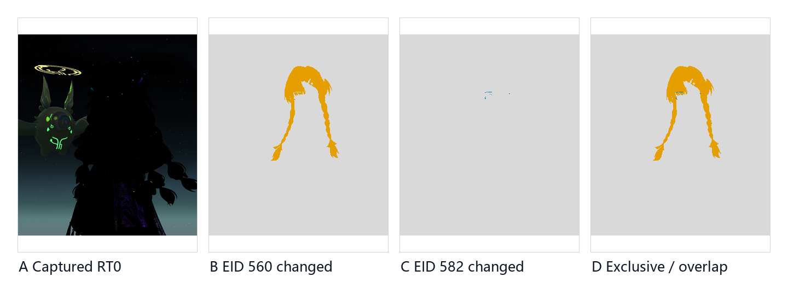

**图 F3-3（DERIVED FROM RAW，SOURCE-LIMITED）**。来源：EID 541→560 与 571→582 的同尺寸 MRT 快照；处理：精确对齐、逐字节差分、跨可读 attachment 求并集、nearest-neighbor 二值显示，橙/蓝/粉分别表示 560-only、582-only、overlap；支持的主张：两个分支在实际 GBuffer 值变化上呈现大范围与小范围的不同覆盖；不支持或尚未证明：写回相同字节的 fragment 会被漏掉，EID 582 RT3 未纳入，因此这不是完整 fragment invocation mask。

把变化强度按同一 p99.5 上限显示，还能看到 560 覆盖更大且在多个 attachment 上都有明显变化，582 在可读通道上的增量非常局部。这符合同一 Bangs 几何按脸域状态选择不同 PS 的机制，但两个 PS 的具体公式差异仍需 DXIL 数据流或受控纹理/参数实验确定。

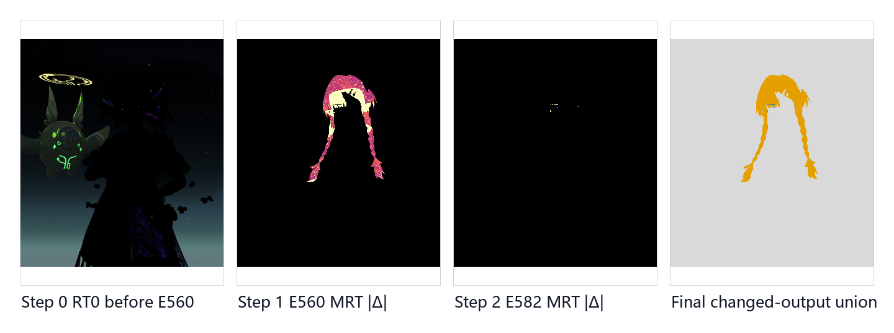

**图 F3-4（DERIVED FROM RAW，SOURCE-LIMITED）**。来源：同 F3-3；处理：七/六个可读 MRT 的最大绝对变化、共享显示上限与最终离散并集；支持的主张：EID 560 与 EID 582 不是相同输出的机械重复，二者在真实 attachment 上留下不同空间变化；不支持或尚未证明：聚合强度不提供每个 GBuffer 通道的业务语义，也不补回缺失的 EID 582 RT3。

至此可逐一排除三个常见误解。

“三次 draw 只是无意义的过绘制”：541 和 560/582 的深度写入、纹理声明和 RT write mask 完全不同，真实的 RT1.B 和 MRT 差分显示了不同结果，不成立。

“541 的 compare 将自身锁定到 Face/Eye”：`0x1A` 完全不测 `0x04`，canonical 2/6/3/7 全部通过，不成立。像素覆盖由几何、深度和已有缓冲共同决定，无法单从 compare mask 概括。

“560 和 582 是任意 Stencil 字节上的补集”：完整枚举有 112 个双命中状态，它们只在 writer 建立的 canonical 子集上呈现所需分区，不成立。

机制总结：Face/Eye writer 把 `0x04` 相关状态写入角色 Stencil，Bangs 随后用同一完整几何执行一次单通道控制写入，再用两个不同谓词选择表面 PS；560 把通过的 normal-role 像素收敛回 `0x02` 相关状态，582 保留 face/eye-role 状态。收益是无需切分刘海网格或准备另一套顶点数据，同一局部就能在脸域交界使用专门着色。代价是额外 draw、深度与 Stencil 依赖、MRT 带宽，以及 compare/write mask 的跨模块耦合。

这是一种可编程的角色分类方法。几何 section 负责粗粒度对象身份，Stencil bit 提供屏幕空间的局部上下文，专用 PS 决定怎样解释相同材质输入。相比把所有分支塞进一个 PS，这种方案更容易控制变体，可能也减少单次 shader 内的动态分支。但协议隐含在位掩码里，工具、文档和调试可视化必须跟上，否则一次看起来无害的新 bit 就可能破坏旧谓词。

### 3.5 Face/Eye writer 写入后续可读的关系

Face 和 Eye 在此有两种身份。它们各自先以 ToonFace 表面材质写正常角色 payload，随后用原 section 范围执行 Stencil writer。后两次事件是 EID 519 和 530：Eye 使用 `first_index=312297`、`index_count=1488`，Face 使用 `first_index=84564`、`index_count=13302`；八个颜色 attachment 的 write mask 全部为零，Stencil 为 `AlwaysTrue + Replace`、`reference=0x06`、`writeMask=0xFE`。两个的像素 shader 都声明了两张纹理且带 discard，因此最终写入的 Stencil 轮廓还可能受材质裁切影响，不能简单等于 section 全部三角形投影。

writer 的职责很明确：未生成可见颜色，而是在已有几何可见性上留下一个能被后续 Bangs 查询的屏幕空间关系。代入前面的等价式，writer 在保留 bit0 的同时写入 `0x02|0x04`。`0x02` 维持角色大类，新增的 `0x04` 让这批像素进入 Bangs 的另一种 canonical 分区。可确认的是新增位参与了后续选择；进一步命名为眼睛遮挡、脸部阴影或 SDF 开关，则超出了固定状态能给出的语义。

F3-1 的实际字节计数：EID 519 后出现 1,506 个值 6 的像素，EID 530 后增加到 3,171 个，EID 541 后计数保持不变。这验证了三件事：第一，状态字母确实由帧内像素写出，不只是 PSO 上理论可能；第二，Eye 和 Face 的写入按命令顺序逐步累积；第三，541 的 Keep 未将 6 改回 2。只看终帧 Stencil 会丢失这种因果顺序。

一种更简单的替代设计是在 Bangs 像素 shader 中直接读 Face/Eye 的深度、材质 ID 或某张脸部 mask，然后动态判断。现有捕获无法证明开发者为何不这样做，但 Stencil 路由的工程收益可分析：writer 把复杂的几何/裁切判定压缩成一位，后续 compare 由固定管线完成；Bangs 的两个 PS 因此可分别编译，避免在一个 shader 内让所有像素携带相同分支和资源路径。代价是多了 writer draw、对顺序和深度状态更敏感，且 bit 的所有权必须跨材质协调。

Stencil writer 与 ToonFace 的具体面部着色是分开的。Face_D、Eye_D 的运行时身份属 near-identical decoded，Face/Eye MI 中的 SDF、阈值、视差和高光参数表明局部材质有专门输入；但 writer 的颜色 write mask 为零，不能用这两次事件证明这些输入如何形成最终脸色或眼睛高光。它们在本章的证据作用仅限于建立供刘海读取的 `0x04` 相关状态。材质画自己和材质给别的 section 留标签，是两件事。

### 3.6 几何、Depth 与事件顺序共同收缩覆盖

如果 `0x02` 和 `0x06` 都通过了 541，为什么 F3-2 的变化仍呈现出具体的刘海投影形状？因为一个 draw 的实际写入集合是多个条件的交集：

```text
observed writes
= rasterized Bangs fragments
∩ viewport/scissor
∩ depth-test pass
∩ stencil-test pass
∩ pixel-shader survival
∩ enabled RT channels
```

EID 541 重放完整 Bangs 索引范围，用 Back cull、`GreaterEqual` 深度测试、关深度写入、只开 RT1.B。捕获使用反向深度比较，`GreaterEqual` 的数值方向不能按传统 less-than 直觉解释；关键是它要求 Bangs 片元与已建立的深度关系成立。`0x1A` 仅排除了某些 Stencil 状态，几何投影和深度才把通过集合收缩到画面上实际可见的像素。541 的变化与脸/刘海交界有关这个推断，可以结合位置和顺序得出；但宣称它由 `0x04` 脸域位限定，与位运算直接冲突。

560 和 582 必须结合顺序理解。560 在 normal-role canonical 状态上写 Bangs 表面并打开深度写入；随后 EID 571 绘制 Hair 主体；582 再在 `0x04` 置位状态上画 Bangs 的另一分支。对 F3-3 做像素差分时，582 的基线必须是 571 之后，而非 560 之后。若跨过中间的 Hair draw，差分会把 Hair 对 MRT 的改变错误归到 582。这个基线选择决定了图展示的是事件增量还是一段混杂的命令区间。

两次 Bangs 表面 draw 共用相同的顶点 shader 短指纹 `A288CE49…5BB3`，像素 shader 分别为 `3752BD13…DC2E` 和 `2FCB853D…40EC`。几何变换路径保持一致，不同的 PS 搭配不同的 Stencil predicate 构成两个表面分支。这能排除第二次只是相同 PSO 的重复提交，但无法确定两个 PS 内部改变了法线、颜色、高光、透明度还是某个 payload 字段。

Depth 写入引入了一个容易忽略的耦合。560 通过后更新深度和 Stencil；582 需要在之后仍能通过自己的深度与 Stencil 条件。当前实际输出说明该排序在本帧成立，但不能由此推断交换两次 draw 仍等价。检验顺序是否为语义合同的最小实验：在可控 replay 中分别跳过 560、跳过 582、交换事件或仅禁用深度写入，随后比较 Stencil、各 MRT 与最终 Kuro Toon 输出。所有实验必须保持相机、姿态、裁剪、光源和曝光不变。

### 3.7 变化像素与执行像素的区分

F3-3、F3-4 使用 attachment 差分。某个像素只有事件前后至少一个已导出字节不同时才进入变化集合。这一定义可复算、可审计，但存在三个盲区。

第一，shader 可能执行但写回的值与原来相同，此时差分为零，变化集合是可观测下界，并非 fragment invocation 的完整集合。第二，EID 582 的 RT3 导出为零字节，现有计算只汇总了六个可读 attachment；若 582 的主要差异落在缺失通道，319 个像素会严重低估其实际覆盖。第三，跨 attachment 的最大差分仅回答哪里有变化，不会自动给每个通道赋予 base color、normal、roughness 或自定义 payload 等业务含义。

Stencil 导出同样有不同边界。F3-1 是每个保存节点后的实际 Stencil 字节，能证明字母表和状态转移；F3-D1/D2 是固定管线 predicate 对 `0..255` 的确定性求值，能证明逻辑集合。前者未直接给出某个 draw 的 tested-pixel mask，后者未给出帧内每个屏幕位置持有的值。两类证据按坐标结合才能得到捕获级测试覆盖。

F3-2 对 RT1.B 的结论停在写入事实。变化后字节 127 对应 UNORM 约 0.498，可能是一个居中控制值，也可能只是量化后的编码常量。在拿到第一个 consumer 的读取、解码和扰动结果之前，不能把 0.498 直接解释为一半阴影、零中心偏移或布尔标记。数值可见不等于语义已知。保留这个边界，后续实验才具有判别力——不同候选语义对 0/0.498/1 的响应应该不同。

本章对四类图使用四种不同的动词：

| 证据 | 可以说 | 不能替代 |
|---|---|---|
| PSO predicate 枚举 | 某个 Stencil 值通过/失败 | 捕获画面上的 coverage |
| Stencil aspect 快照 | 某节点后像素持有值 2/6/128 | 某 draw 实际执行次数 |
| MRT 前后差分 | 已导出通道发生可观测变化 | 完整 shader invocation mask |
| 几何与 shader 指纹 | draw 重放同一 section/更换 PS | PS 内部高级语义 |

把通过、持有、变化、执行混成一个覆盖，后续关于脸域、刘海阴影和材质分支的推理就多走了一步。

### 3.8 三次绘制的成本分配

为什么不一次画完 Bangs？从捕获能确认的结构看，开发者把同一份工作拆成了三种成本轮廓。541 复用完整几何，但不采样纹理、不写深度、只写一个 8-bit 通道；560/582 复用同一个 VS 和七张声明的纹理，让固定管线先按状态筛选，再分别执行两个 PS。额外的 draw call 和几何重放换来了更窄的颜色带宽、更明确的 shader 变体，以及由 Stencil 预分类的局部执行域。

这种选择并不天然更快。Bangs 有 29,307 个索引，三次提交会产生额外的顶点处理、状态切换和栅格化开销；Face/Eye writer 也有自己的 draw。反之，若让一个 PS 同时承担控制写入、普通刘海和脸域交互，可能需要更多资源绑定、动态分支和输出路径，wavefront 内不同像素的分歧也会增加。目前证据只能说明架构选了多 pass 预分类这一侧，从一帧捕获无法推导 GPU 时间优势。性能结论需要 event duration、管线统计和受控开关测试。

美术控制上的收益更直观。Face/Eye 声明屏幕空间关系，Bangs 决定自己如何响应；两者无需共享拓扑切割，也无需把脸域边界永久烘进刘海 UV。角色换姿态或相机运动后，关系由当帧几何和深度重新生成。若将来同一套 Bangs 材质用于另一张脸，只要 writer 和 consumer 对 bit 和 payload 的合同保持一致，协议即可复用。代价是这种关系在材质编辑器里不够直观：单看 Bangs MI 找不到 541 的常量写入，单看 Face MI 也看不到 582 的读取分支。

对于迁移和工具设计，关键在于可观察的层次。一个合格的调试视图应并排显示 section、当前 Stencil 字节、541 前后 RT1.B、560/582 可观测 MRT 增量，以及最终 resolve 差异，每层可单独冻结。这样才能判断错误来自几何映射、writer、predicate、局部 PS，还是全屏解释器。若在 Blender 中直接拿一张手绘脸部 mask 追踪终帧相似度，短期可能更快，但长期无法回答原协议在视角、姿态和遮挡变化下的工作方式。

本章确认了一组跨模块合同：Face/Eye 以无颜色写入建立 `0x04` 相关状态；541 在完整 Bangs 可见覆盖上只改 RT1.B，语义仍未闭合；560/582 在 canonical 状态上选择两个不同 PS；560 的 Replace 将其分支收敛回 `0x02` 相关状态；完整 8 位空间仍保留 112 个双命中值。这份合同足以指导下一轮 pixel history、consumer 追踪和行为重建，也表明开发者是在设计一套角色内部路由，而非将七个材质彼此孤立地堆在一帧中。

## 4. ToonCommon：一个字节、五个区域和未知高位

Stencil 决定这个像素交给谁，ToonCommon 接着决定角色分支拿到这个像素后有哪些局部参数可用。Up、Down、Cloth 三个 section 共享这个家族，覆盖上衣、下装和带透明裁切的布料。如果给每个美术区域各拆一个材质槽，section 数量、draw 数量和变体管理会迅速膨胀。这里的做法是把区域编号塞进一张 RGID 图，同一个材质实例携带编号化的参数组。

### 4.1 低四位是稳定的五区域字母表

对 Cloth、Down、Up 三张原始 RGID PNG 逐像素枚举，原始字节分别有 15、15、13 种取值，但执行：

```text
region = value & 0x0F
high_nibble = value >> 4
```

三张图的 `region` 都严格只出现 0、1、2、3、4。这是对 4,194,304 个字节逐一计算的结果，非凭文件名或颜色猜测。材质实例中存在 `0_...` 到 `4_...` 五组编号化参数，低四位作五区域选择器是目前最强解释。仍标为 inferred，原因是未在 Kuro Toon 内部定位到最终的索引语句——统计结构与参数结构对齐，尚不等于源码变量名已知。

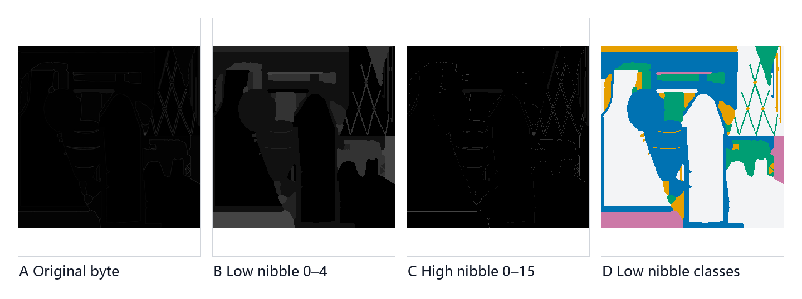

**图 F4-1（DERIVED）**。来源：`../fig/raw/source/textures/T_R2T1XigelikaMd10011Down_RGID.png`；处理：原始字节、`value & 0x0F`、`value >> 4` 与低位离散着色，所有 mask 使用 nearest-neighbor；支持的主张：低四位形成清晰的 0–4 分区，高四位也携带非零结构；不支持或尚未证明：图没有给高位赋予任何开关名称，也没有证明低位在最终 resolve 中的具体采样代码。Claim：`C-RGID-LOW-NIBBLE`、`C-RGID-HIGH-NIBBLE`。

三件服装并排后，低位区域的共同语法更明显。编号沿 UV 岛和装饰结构交错出现，而非按整张贴图从左到右分块：主体面料、边缘、装饰带、金属或高亮局部可以在一个 section 内被重新分组。对美术生产而言，这比新增材质槽更轻：网格拓扑保持不变，换色或局部响应靠一张低成本索引纹理和五组参数完成。

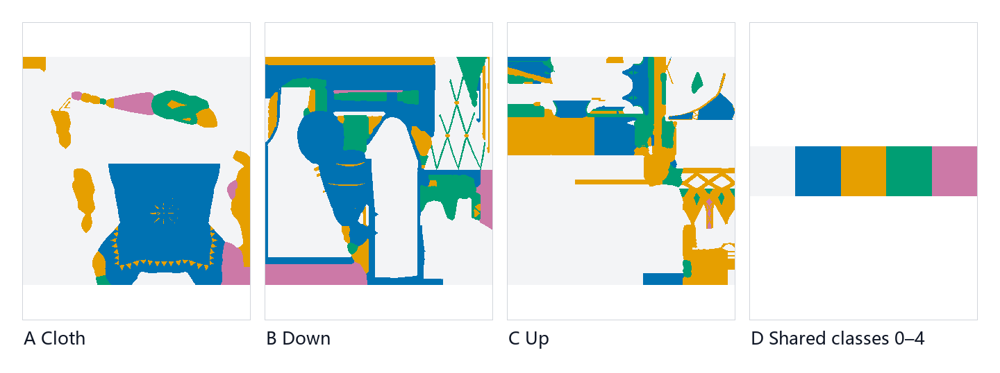

**图 F4-2（DERIVED）**。来源：Cloth_RGID、Down_RGID、Up_RGID 的原始字节；处理：同一低四位公式、同一离散 palette、nearest-neighbor；支持的主张：三个 ToonCommon 实例共享 0–4 区域字母表，区域空间形状则由各自 UV 与资产决定；不支持或尚未证明：相同编号不意味着三个实例的颜色、Ramp、PBR 或发光参数数值相同。

区域编号不同于材质类型。编号 2 在 Down 上可能对应一块装饰，在 Cloth 上可能位于另一种织物岛；运行时实际取到的属性来自当前 MI 的第 2 组参数。低四位更像局部数组索引，非全角色统一的语义枚举。Blender 迁移时应保留数值索引和每个实例自己的参数表，勿将 0–4 硬编码为皮肤、金属、布料等跨资产名称。

性能方面，单字节区域图让一个 draw 处理多个局部外观，减少了 section 和 PSO 切换；代价是 shader 需要选择参数组，美术资产、MI 参数命名和调试工具必须对编号保持一致。若区域数量将来超过 16，低 nibble 的容量会成为硬限制。目前仅用五类，空间充足。

### 4.2 高四位的未知语义

高位非零像素不是随机噪点。重新统计得到：

| 纹理 | 高四位非零像素 | 比例 |
|---|---:|---:|
| Cloth_RGID | 75,841 | 1.808190% |
| Down_RGID | 174,260 | 4.154682% |
| Up_RGID | 93,011 | 2.217555% |

这些像素沿特定 UV 边缘和局部花纹分布，说明高位是资产结构的一部分，但业务含义未知。它可能是第二个索引、布尔标志组合、局部 Ramp 选择、描边或特效控制，也可能只是离线打包流程保留的字段。仅靠 1.8%、4.15%、2.22% 的频率无法在这些候选解释中裁决。

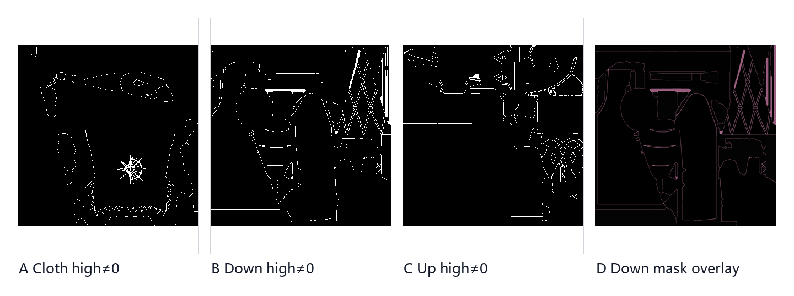

**图 F4-3（DERIVED）**。来源：三张原始 RGID；处理：`(value >> 4) != 0` 二值化与 Down 原图叠加，mask 采用 nearest-neighbor；支持的主张：高四位非零区域稀疏但空间上有组织，比例可由脚本复算；不支持或尚未证明：任何具体材质开关、Ramp 分支或轮廓语义。Claim：`C-RGID-HIGH-NIBBLE`。

最小实验是建立高位值分层 A/B，而不是看图猜名称。固定相机、灯光与曝光，把高四位分别清零、保持原值、替换为单一值，低四位不变；在 BasePass GBuffer、Kuro Toon 输出和最终 SceneColor 三个阶段找第一个发生变化的资源。若变化在 BasePass 出现，高位可能参与局部 payload 写入；若 BasePass 不变而 Kuro resolve 变化，它更可能是下游解释字段；若全链无差别，还需检查当前变体是否消费它。

未知项落到操纵哪个变量、观察哪个最早输出、怎样算通过，而非在文章结尾列一堆名词。高位现保留为 unknown upper field。

### 4.3 Packed Normal：R/G 重建 Z

Down_N、Up_N、Cloth_N 还有一个异常——B 通道最大值只有 4，而 R/G 呈现完整的法线式变化图。对 R/G 做：

```text
x = 2R - 1
y = 2G - 1
z = sqrt(max(1 - x*x - y*y, 0))
```

三张图落在 XY 单位圆内的像素比例分别是 99.992394%、99.963474%、99.991226%，强烈支持 R/G 存切线空间 XY、Z 在使用时重建的行为模型。剩余极少量越界像素可由量化、边界或无效 UV 区域解释，脚本用 `max(...,0)` 保持数值稳定。

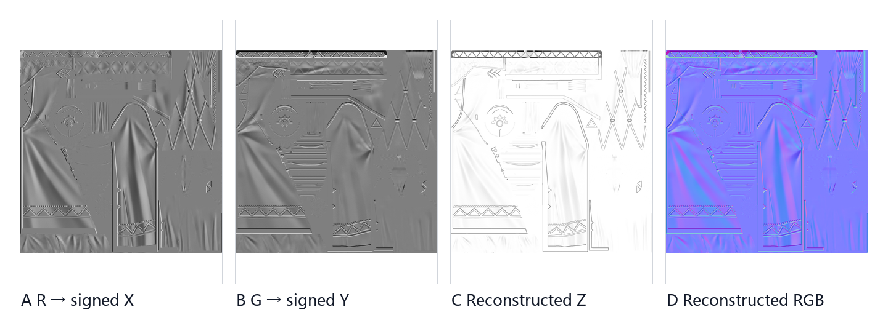

**图 F4-4（DERIVED）**。来源：`Down_N.png` 的 R/G；处理：UNORM→signed XY、单位半球 Z 重建与 RGB 显示，统一固定范围；支持的主张：R/G 形成可复算的法线 XY，重建后得到连续的单位半球可视化；不支持或尚未证明：这不是 shader 反编译结果，B/A 的业务用途仍未知，切线基与最终世界空间变换也未在图中恢复。Claim：`C-NORMAL-XY`。

专门展示错误地使用 B 这个候选，是因为离线 PNG 有四个通道，最自然的迁移错误就是把 RGB 直接连到 Normal。但 B 最大只有 4，映射到 signed 范围后几乎恒为 -1；再归一化会把大量法线压到错误半球。这个错误在静态材质球上可能只是光有点奇怪，容易被调灯光掩盖，但实际是系统性崩溃。

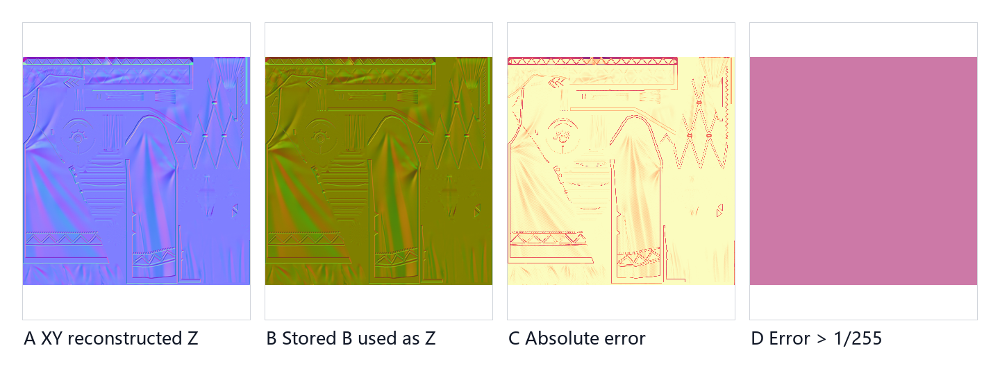

**图 F4-5（DERIVED COUNTEREXAMPLE）**。来源：同一 Down_N；处理：A 使用 R/G 重建 Z，B 把存储 B 映射为 Z 后归一化，C 为逐通道绝对差，D 为误差大于 `1/255` 的离散 mask；支持的主张：两种解释产生系统性而非局部误差，因此 Blender 迁移不能直接把 RGB 当完整法线；不支持或尚未证明：A 是证据支持的迁移假说，不是对原 shader 高级源码的逐句复原。

法线打包的开发收益：R/G 可用适合二维法线的压缩方案，B/A 留给其他低频控制或打包字段，下游统一重建 Z。成本是离线工具必须知道通道合同，边界像素需要安全钳制。若工具按普通 RGB 法线导入，结果可能看起来还能用，但后面所有 Ramp、specular 和 outline 调参都建立在错误基线上。

### 4.4 Cloth：家族内特例

Cloth 的 PSO 和 MI 暴露了 NoCull、双面、discard、`clip≈0.3333`、FX 和 HDR emission 这些特征。它比 Up/Down 多了一组透明裁切和双面处理，但 section 仍进入 ToonCommon 家族、使用相同的 RGID/packed-normal 组织方式，并参与同一角色路由。把 Cloth 单独命名成另一套光照模型夸大了差异。

开发者选择了共享局部 payload 合同，在几何可见性和特效字段上派生变体。布料边缘需要 discard，薄片需要双面，装饰需要 emission——这些要求改变 BasePass 如何产生像素，但不必改变后续角色光照对 ToonCommon payload 的识别。这样既保留统一 resolve，也允许材质域内的必要特例。

代价在于变体数量。NoCull、masked、FX、emission 的组合可能生成更多 PSO；discard 还会影响 early-Z 效率。开发者似乎接受了这部分局部成本，以省去把衣片拆成更多 section。Blender 迁移也应先复刻同一家族变体的结构：公共 RGID/normal 解码放在一处，Cloth 仅在双面、alpha clip 和 emission 上加分支，而非复制整张网络。

Shading ID 12 只说明这是正常角色表面，不能独自决定每个区域的外观；ToonCommon payload 里的低位区域、参数组和重建法线提供了更细的解释输入。下一章 ToonHair 沿用相同原则，将二维区域控制扩展为 HM/HN/HR 的方向性行为。

## 5. ToonHair：HM/HN/HR 的行为模型

头发大概是最容易看图编公式的地方。终帧里能看到稳定的高光带，MI 里又有 channel、position、width 这类参数，容易让人写出一段看起来合理的乘法和 Ramp 采样。但没有 shader debug 或 DXIL 数据流闭环，精确公式仍然未知。这一章仅建立由尺寸、通道变化、绑定身份和参数分组共同支持的行为模型。

确认层包括四件事：

1. Hair_HM 与 Bangs_HM 都是 2048×2048 多通道纹理；
2. Hair_HN 与 Bangs_HN 都是 512×512，主要变化集中在 R/G，B/A 固定为 255；
3. Hair_HR 是 512×4 的极窄查表；
4. Hair 与 Bangs 的 MI 都有三组 channel/position/width 型参数。

这些事实说明数据被分成“高分辨率局部权重”“较低分辨率方向/坐标输入”“极低高度颜色或强度查表”三个尺度。它们非常适合构建可控的卡通头发响应，却不足以确认采样顺序和组合算子。

### 5.1 HM：高分辨率局部权重

HM 的 R/G/B 并非同一张灰度图的复制。Hair 和 Bangs 各通道的空间图案不同：某些发束集中在 R，另一些结构在 G/B，Alpha 基本恒定。这支持多通道 mask 或权重集合的解释，但不支持将任一通道直接命名为主高光、次高光或遮蔽。

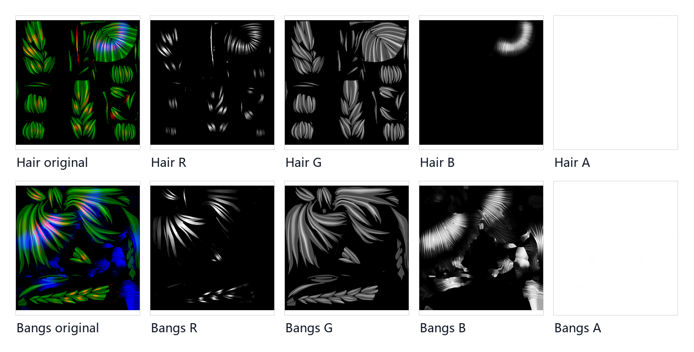

**图 F5-1（RAW CHANNELS）**。来源：Hair_HM 与 Bangs_HM 原始 2048×2048 PNG；处理：RGBA 按固定 `[0,255]` 灰度拆分、共享显示范围；支持的主张：HM 是多通道且 Hair/Bangs 空间内容不同，足以提供发束级局部权重；不支持或尚未证明：各通道的 shader 变量名、混合公式和最终高光含义。Claim：`C-HAIR-BEHAVIOR-MODEL`。

HM 使用 2048 分辨率有其设计意图。高光位置随视角变化，但美术希望发束边界、局部弱化和装饰遮挡稳定贴在模型上，高分辨率 mask 可承载这种 UV 空间结构。若所有形状都由屏幕空间法线即时推导，美术很难精确控制某根发束；若把最终高光直接烘进颜色，视角变化又会失真。HM 介于两者之间：提供局部可控权重，让后续方向输入和参数决定动态部分。

### 5.2 HN：较低分辨率的二维输入

HN 的 R/G 变化丰富，B/A 固定 255。将 R/G 映射到 `[-1,1]`，可确定性计算角度和长度，得到二维场可视化。这个场仅描述像素值分布，不声称它已经是切线、梳理方向或最终高光坐标。

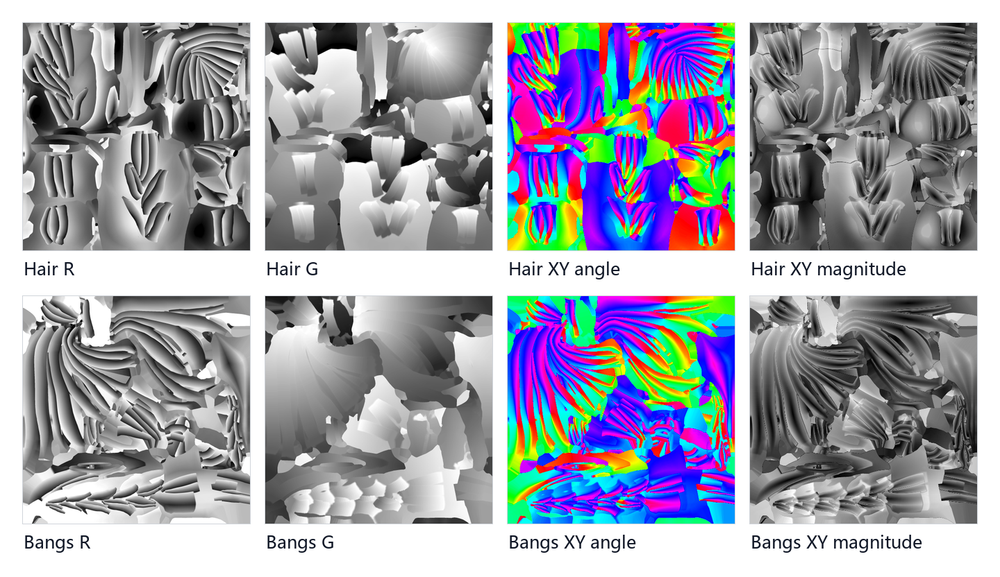

**图 F5-2（DERIVED）**。来源：Hair_HN、Bangs_HN；处理：R/G 原通道、`x=2R-1`、`y=2G-1`、`atan2(y,x)` 色相和 `length(xy)` 灰度；支持的主张：HN 的有效变化集中于二维输入，Hair/Bangs 的方向结构不同；不支持或尚未证明：角度图是分析可视化，不等于运行时使用的向量空间或采样公式。

HN 为 512 而 HM 为 2048，合理推断是方向/坐标场比局部权重更平滑，低分辨率已足够；四倍边长差带来的内存和带宽节省显著。另一种可能是 HN 并非方向，而是两路独立标量。R/G 可视化仅证明二维结构，不能排除这种用法。最小实验应分别把 R、G 钳制到 0.5，在相同相机轨迹上比较高光是移动、变宽还是仅强度变化。

### 5.3 HR：四行查表

512×4 的 HR 若按普通纹理缩略图显示，几乎是一条线。用 nearest-neighbor 放大并拆行后，四行各自有连续的颜色/强度变化，逐行平均曲线也各不相同。这种形态更接近四条一维 Ramp 或一个有四离散层的 lookup，而非给 UV 岛贴的二维图案。

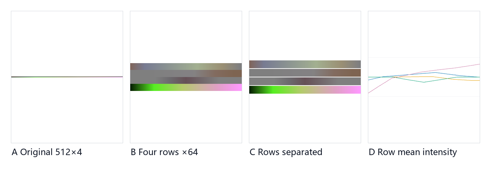

**图 F5-3（RAW/DERIVED）**。来源：Hair_HR 512×4 原始 PNG；处理：nearest-neighbor 放大、四行分离与逐行 RGB 平均曲线；支持的主张：资源由四条可区分的横向查表组成，横轴可承载连续 lookup；不支持或尚未证明：哪一个参数选择行、横坐标怎样计算、返回值表示颜色还是强度。

四行设计的收益是把艺术曲线塞进极小纹理：shader 计算一个连续坐标，按某个离散类别选行，即可获得可编辑的色带或强度响应。对比把复杂曲线硬编码进 shader，Ramp 更容易被美术迭代；对比完整二维 LUT，512×4 的缓存和带宽代价极低。风险是采样精度、行间过滤和颜色空间必须严格设置，否则四行会互相污染或在不同工具中产生不一致。

### 5.4 运行时身份：同源不是同文件

Hair_HN、Bangs_HN、Hair_HR 三项在解码像素层达到了 pixel-exact；Hair/Bangs 的 HM、FTM 等多项属于 near-identical decoded。下面直接比较 HM 的本地 PNG 和捕获 preview。Hair_HM 的差异极少，Bangs_HM 也只在少量字节上有 1 级误差——但这仍然不能写成文件哈希相同。

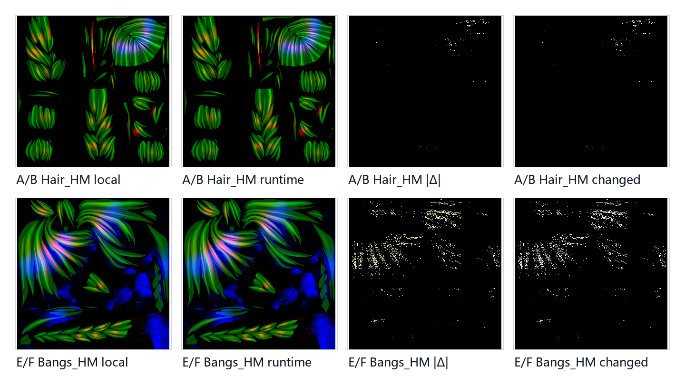

**图 F5-4（DERIVED）**。来源：本地 Hair_HM/Bangs_HM 与 EID 571 `ResourceId::1197815`、EID 560 `ResourceId::1197795`；处理：同尺寸精确对齐、UNORM 字节绝对差、共享差分显示和变化像素 mask；支持的主张：两组与本地资产高度同源且属于 near-identical decoded；不支持或尚未证明：解码近似不等于 PNG 文件、GPU 压缩块或资源容器 byte-exact。

名字相同或纹理相近不足以确认捕获绑定的就是离线解包的那一张；反过来，少量压缩误差也不该被错判为不同资产。3/8/8 分级保留了这种中间状态：零像素误差进 pixel-exact，极高相关加极小误差进 near-identical decoded，其余保持 unresolved。

### 5.5 安全的行为模型与它的边界

目前证据允许写出的模型是：

```text
HM：局部区域或权重
× HN：二维方向/坐标候选输入
→ Position / Width 参数：形状与位置控制
→ HR：一维连续查表与四行离散选择
→ 头发 payload，随后由角色 resolve 解释
```

箭头表示数据职责，非已确认的乘法次序。HM 和 HN 可能先混合，也可能各自影响坐标和幅度；Position/Width 可能在多个高光层上使用；HR 可能输出 RGB，也可能只是中间权重。这些不确定性应被保留。

从 Hair 到 Bangs，模型又多了一层屏幕空间上下文。Hair 主体在 EID 571 做一次表面写入；Bangs 除了 HM/HN/HR 型输入，还经历了 541 的 RT1.B 控制写入，以及 560/582 的 Stencil 分区。Bangs 是头发行为与脸域交互的复合实例，而非另一种独立头发材质。

方向性高光由可复用的 ToonHair 家族处理，脸部交界问题由 Stencil 和专用 pass 处理；Hair/Bangs 能共享大部分输入合同，又不让整个头发 shader 承载脸域分支。成本是 Bangs draw 增加、状态排序更严格、RT1.B 下游语义变得隐含。调试工具宜同时提供 HM/HN/HR 通道查看、Stencil canonical 值和 RT1.B consumer 跟踪，否则单看材质面板无法理解终帧。

Blender 复刻时，第一阶段仅实现证据支持的输入层：HM 四通道、HN.RG signed 解码、HR 四行 nearest/linear 采样选择、三组 Position/Width 参数容器。第二阶段用受控测试逐项确定通道作用，而非先调出一张相似截图再倒推公式。固定相机轨迹下的高光位置、宽度、强度和遮挡均分别对齐后，行为模型才可升级。

## 6. Outline：反壳作为另一类角色表面

轮廓阶段没换网格，也没在 SceneColor 上直接做边缘检测。EID 599–653 重新用了 Up、Down、Cloth、Hair、Bangs、Face 的原始索引区间，统一换成 Front Cull，只保留扩张壳层的背面，像素阶段打包 Shading ID 13。正常表面用 ID 12，表面和轮廓在几何层面分开，但进的还是同一套角色 GBuffer 合同。

| Section | Outline EID | indexCount / firstIndex | shader 变体线索 | 六个 draw 的共同状态 |
|---|---:|---:|---|---|
| Up | 599 | 98,430 / 97,866 | 与 Down 共用 VS 与 PS | Front Cull、ID 13、RT5 write mask `0x00` |
| Down | 608 | 72,630 / 196,296 | 与 Up 共用 VS 与 PS | 同上 |
| Cloth | 619 | 43,371 / 268,926 | 独立 VS/PS，保留 discard | 同上 |
| Hair | 631 | 55,257 / 29,307 | 独立 VS，共用 Up/Down 的 outline PS | 同上 |
| Bangs | 642 | 29,307 / 0 | 独立 VS/PS 变体 | 同上 |
| Face | 653 | 13,302 / 84,564 | 独立 VS/PS，PS 不声明纹理 | 同上 |

六个事件在第二帧分别复现为 918、927、938、950、961、972，仍保持固定 `+319` 偏移。索引区间、Front Cull、ID 13 和 RT5 禁写，两帧状态共同支持。Eye 未出现在这组反壳 draw 中，现有证据只能说明该序列不含 Eye section。

### 6.1 为何未合并为一个 outline draw

Up 和 Down 完全共用 outline VS/PS，开发者未给每件衣物准备独立算法。但 Cloth 保留了 discard，Hair 用了另一份 VS，Bangs 和 Face 又各有变体，反壳并非无条件的统一法线膨胀。所有 section 遵守共同的反壳加 ID 13 输出协议，但在顶点扩张、裁切和局部参数读取上允许变体。

这样拆分的好处：第一，轮廓宽度或扩张方向可按部件控制，长发、身体衣片和脸部不必接受同一尺度。第二，Cloth 仍可丢弃不应产生壳层的像素，避免镂空或装饰区域被一圈实线封住。第三，原 section 和骨骼蒙皮关系被保留，轮廓随动画和局部变形移动，不依赖终帧边缘检测去重新猜测对象边界。

成本：角色在正常表面之后又提交六次完整 indexed draw，增加顶点处理、栅格化和状态切换；膨胀壳层还可能在凹面、细发束和相邻 section 接缝处穿插。分 section 调参能缓解问题，但也把资产规范、材质参数和 shader 变体绑得更紧。若某个 section 的顶点方向、蒙皮法线或宽度数据异常，错误会直接表现为局部轮廓断裂。

### 6.2 ID 13：可解释性

如果反壳只管画一圈固定黑色，最短路径可以是前向透明叠加或直接写 SceneColor。这里偏偏让壳层继续写角色 MRT，还用 ID 13 跟正常表面的 ID 12 区分。可以推断，开发者希望后续角色 resolve 能识别轮廓表面像素，而非把它当普通衣料、头发或皮肤重新照明。

但 ID 13 的内部公式仍未知。它可能选固定色，也可能改变受光、雾、环境反射或材质参数的读取方式；当前结构化状态只证明 ID 被打包，不提供 ID 12/13 在 EID 1377 内部的逐指令分支。RT5 对所有 outline draw 都关掉了写入，同样只能确认轮廓 payload 有意缺少或保留了该目标中的既有内容。

与屏幕空间边缘检测比，反壳对对象身份更稳定，也不会把脸部明暗分界误判为外轮廓；与单次整角色反壳比，六 section 提供了更细的美术控制。替代解释仍需保留：不同 VS 可能来自编译变体、顶点格式或蒙皮路径，不一定全对应肉眼可见的宽度差异；不同 PS 也可能仅为 discard 或资源布局服务。区分这些需要实际导出 outline-only、逐 section build-up，以及同一顶点在正常 VS 和 outline VS 后的位置差，目前标为 pending。

:::warning[待补证据 F6-1｜ID 12/13 与反壳轮廓的实际 GBuffer 分布]
**需要：** EID 582 后的 outline-off 基线、EID 599→608→619→631→642→653 的同资源逐步输出、outline-only 差分，以及经 DXIL/output signature 确认的 Shading ID 通道。

**当前能确认：** 六个 draw 精确复用六个 section，使用 Front Cull、写 ID 13，并统一关闭 RT5 写入；正常表面打包 ID 12。

**当前不能确认：** ID 12/13 的实际屏幕分布、各 section 可见宽度/颜色差异，以及顶点阶段的扩张方向、距离补偿或顶点色权重公式。采集合同见 [`capture-todo.md`](/research/wuwa-xigelika-rendering-protocol/capture-todo.md)。
:::

本章可闭合的是轮廓仍属于角色协议，非轮廓公式已还原。Blender 迁移时，第一版应保留六个材质区独立控制、Front Cull 反壳与 outline role ID 三项行为；具体膨胀算法作为候选实现，在固定相机距离与多个视角下比较，不能因某一张截图边缘接近就定案。

## 7. Standard Deferred 与 Kuro Toon 的像素域互斥

EID 1363 和 1377 在命令流中前后相邻，且都写 SceneColor `ResourceId::1430956`。只看事件顺序，容易叙述为先算一遍普通延迟光照、再在相同角色像素上覆盖 Toon 结果。Stencil 状态推翻了这种理解：

```text
EID 1363: (S & 0x02) == 0x00
EID 1377: (S & 0x02) == 0x02
```

同一个 Stencil byte 的 `0x02` 位只能是 0 或 1，所以两个 tested domain 完全互斥，并集覆盖整个 8 位输入域。1363 用 `DeferredLightPixelMain`、三索引全屏三角形、Reference 0、Compare Mask `0x02`；1377 用 `KuroToonShadingPixelShader`、六索引全屏几何、Reference `0x02`、相同 Compare Mask。两个都关掉了深度测试写入，Stencil operation 为 Keep。这里的角色路由由固定管线状态直接给出，而非从 pass 名字推导。

### 7.1 四个层次不能混为一谈

把证据拆成四层：

| 层次 | 当前能确认 | 当前不能据此推出 |
|---|---|---|
| Command order | 1363 先提交，1377 后提交 | 后一个 pass 重算或覆盖前一个 pass 的同一像素 |
| Pixel set | 1363 接受 bit `0x02` 清零域，1377 接受置位域，二者互斥 | 两个集合的亮度、材质类别或视觉重要性相同 |
| Shared inputs | 两个全屏阶段都位于 GBuffer 完成之后，并按各自 reflection 声明读取多项纹理 | 每项输入在两套 shader 中具有相同语义或相同权重 |
| Per-pixel model | 两个事件使用不同 PS 哈希和高级函数标签 | Kuro Toon 内部的明暗阈值、Ramp、ID 12/13 分支与能量模型已知 |

Stencil bit `0x02` 充当粗粒度路由标签。没有该位的场景像素交给标准 deferred 路径；带该位的角色协议像素交给 Kuro Toon resolve。上游 BasePass 写好 GBuffer、Stencil 和 Shading ID 即可；下游两个专用阶段各处理自己的域。

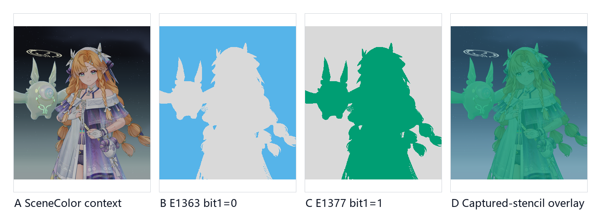

**图 F7-1（RAW/DERIVED）**。来源：EID 1377 后保存的 D32S8 Stencil 与 `ResourceId::1430956` HDR 场景上下文；处理：在同一 2560×1440 Stencil byte 上分别计算 `(S&0x02)==0` 与 `(S&0x02)==0x02`，使用固定角色裁剪、nearest-neighbor 离散 mask 和共享 Reinhard→sRGB 上下文显示；支持的主张：`C-LIGHT-1363-1377-ROUTE`，捕获中 standard domain 为 2,956,118 像素、Toon domain 为 730,282 像素，overlap 为 0、union 为 3,686,400；不支持或尚未证明：tested coverage 不表示两套 shader 的亮度、计算量或内部公式，也不证明每个通过像素都产生非零 SceneColor 增量。

图中的两种颜色仅表示集合，非普通像素先变成橙色再被蓝色覆盖。同一角色附近同时有头发、衣物、背景和透明物，终帧颜色边界无法可靠替代 Stencil tested pixels。只有对保存的 byte 逐像素执行已确认的 predicate，才能回答两个 pass 实际被允许处理哪些位置。

### 7.2 前后差分

EID 1363 和 1377 之间还有 EID 1369、1376，但 action signature 显示它们不写 `ResourceId::1430956`。同一 HDR 资源在 1363 后和 1377 后的差分，可以隔离这个区间内唯一一次 SceneColor 写入。这是完成 bit `0x02` 清零域之后到再完成置位域之后的增量，而非两套光照在同一像素上的 A/B。

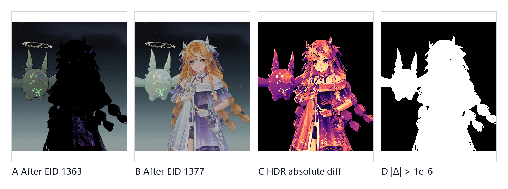

**图 F7-2（DERIVED FROM RAW）**。来源：EID 1363 与 1377 后同一 `ResourceId::1430956` 的线性 RGBA EXR；处理：精确配准、固定角色裁剪、共享 Reinhard→sRGB 显示，在线性 float 上计算 absolute diff，并以 epsilon `1e-6` 生成变化像素；支持的主张：`C-LIGHT-1363-1377-ROUTE`，该区间变化像素比例为 `0.19809434678819443`，变化像素数 730,255，与 Toon tested domain 的规模高度一致，最大绝对通道差为 `2.5712890625`；不支持或尚未证明：差分不恢复 `KuroToonShadingPixelShader` 的内部计算，也不能把 ID 12 与 ID 13 的具体输出效果从总增量中分离。

730,255 个变化像素比 730,282 个 tested 像素少了 27 个，这不构成路由矛盾。通过 Stencil 只意味着 shader invocation 有资格作用于像素；输出可能恰好保持原值、被写成数值一样的结果，或者因为 epsilon 阈值没进入变化 mask。反过来说，两个数量接近也不等于逐像素一一对应——仍然应该用保存的 coverage 和 HDR 差分分别去描述。

F7-2 纠正的是事件级叙事，非替代 shader debug。它确认了 1377 向同一 SceneColor 写入了可见的角色域结果，且这段变化能与 bit `0x02` tested domain 对照；但未给出 ID 12 如何计算普通角色表面、ID 13 如何计算轮廓，也未证明二者仅差一个颜色常量。ID 12/13 更像是角色域内部的第二级解释键，而 Stencil bit `0x02` 是进入角色 resolve 的第一级门。前者的逐像素分支仍是未知项。

### 7.3 两个 pass 的代价与收益

把标准域和 Toon 域拆成两个全屏阶段，避免了在一个巨型 shader 里让每个像素都携带角色和非角色的大量分支。Stencil early test 先过滤像素，两套 PS 各自维持适合自己的资源布局和数学模型；普通场景继续使用成熟的延迟照明，角色则获得 Ramp、离散 ID、面部/头发控制量等专用解释空间。角色 shader 可以独立迭代，无需把风格化逻辑塞进所有场景材质。

代价是额外的全屏提交、更多 PSO 和资源绑定，以及一个必须横跨 BasePass、Stencil writer、outline 和 lighting resolve 保持一致的协议。任何一个上游 writer 漏写 `0x02`、错误保留旧 bit、或者把非角色对象标进了角色域，像素就会被送进错误的光照分支。边缘处的 MSAA、深度覆盖和透明合成也得另行处理。

替代架构包括单次 deferred shader 内按 Material ID 分支，或先统一照明再做纯颜色后处理。当前捕获证明本帧未选这两种方案，而是用了两个 Stencil 路由的 lighting pass。其动机（性能、着色自由度、引擎兼容或团队工作流）属于推断范畴，可确认的是机制和成本边界。

## 8. SSR 与 Reflection

EID 1377 结束后，SceneColor 已包含角色 Toon 域的写入，但整帧还没跑完。后面 EID 1421 生成全分辨率 SSR 中间量，EID 1432 读取这个中间量、GBuffer 和环境输入，写回 SceneColor。目前的证据适合用资源读写表表达。

| 阶段 | EID / shader 标签 | 已确认的读取 | 已确认的写入 | 证据边界 |
|---|---|---|---|---|
| Toon domain result | 1377 / `KuroToonShadingPixelShader` | 角色 GBuffer 与该 PS 声明的输入 | SceneColor `ResourceId::1430956` | 只确认角色域写入，不含 ID 12/13 内部公式 |
| SSR generation | 1421 / `ScreenSpaceReflectionsPS` | 该 PS 声明的 8 个纹理资源；逐项业务语义未全部命名 | `ResourceId::1430965`，2560×1440，`R16G16B16A16_FLOAT` | 只确认全分辨率 SSR 中间量身份 |
| Reflection composite | 1432 / `ReflectionEnvironmentSkyLighting` | `ResourceId::1430965` 加 GBuffer／环境输入 | SceneColor `ResourceId::1430956`，2560×1440，`R16G16B16A16_FLOAT` | 资源流不量化每种角色材质的反射贡献 |

### 8.1 Toon 与 Reflection 分离的设计

这条顺序体现了清晰的职责分配：角色明暗块、Ramp 和轮廓解释由 Kuro Toon 阶段负责；SSR、天空和环境一致性留给后面的场景级模块。这样角色可保持非写实的局部受光，同时金属装饰、光滑衣片或环境高亮仍有机会带来空间联系。若所有反射都在每个 Toon 材质内部各自实现，资源访问、质量开关和场景一致性将更难统一。

工程收益是模块复用：SSR 和 Reflection composite 服务整帧，角色仅需通过 GBuffer 提供足够的法线、粗糙度或其他候选控制字段。代价是一个 2560×1440 的四通道半精度浮点中间量会增加显存和带宽压力；角色 GBuffer 的字段约定必须与通用反射模块兼容。若 Toon resolve 产出的法线、粗糙度或 SceneColor 与后续模块预期不一致，角色可能出现亮度过高的反射、轮廓被环境污染或风格块面被连续高光破坏。

这里仍有多个替代解释。`ResourceId::1430965` 可以包含整帧 SSR，但角色在其中的实际贡献可能很小；某些角色材质也可能通过粗糙度、遮罩或后续条件基本拒绝了 SSR。1432 同时读环境和 GBuffer 输入，所以它的 SceneColor 增量不能直接等同于”SSR 贡献”，更不能泛化成每种角色材质都有明显屏幕空间反射。只有逐阶段 raw 输出和同 ROI 差分才能把 SSR intermediate、环境项和最终 composite 拆开。

:::warning[待补证据 F8-1｜Kuro Toon、SSR 与 Reflection 的真实逐步输出]
**需要：** EID 1377 后的 `ResourceId::1430956`、EID 1421 输出的 `ResourceId::1430965`、EID 1432 后的 `ResourceId::1430956`，均以线性 RGBA、相同 2560×1440 视口、固定角色 ROI 和共享显示变换导出，并计算可复算的 absolute diff。

**当前能确认：** 1421 写全分辨率 `R16G16B16A16_FLOAT` SSR 中间量；1432 读取它及 GBuffer／环境输入并写回同格式 SceneColor。

**当前不能确认：** 三阶段在角色各材质上的可见增量、SSR 与环境反射的独立占比，以及轮廓 ID 13 是否参与或抑制反射。采集合同见 [`capture-todo.md`](/research/wuwa-xigelika-rendering-protocol/capture-todo.md)。
:::

当前最强结论是资源级模块关系，非视觉贡献比例：Toon resolve、SSR generation 和 Reflection composite 在命令和资源上形成连续链，角色风格化结果未脱离后续场景合成。F8-1 的 raw 输出补齐前，不能将此链画成已观测的逐步成片，也不能仅凭事件顺序为任何材质指定反射强度。

## 9. 未知项：下一轮实验的输入

到这里，角色渲染的主要协议已能由事件、资源、固定功能状态和确定性像素处理相互印证。但能描述运行流程不等于知道每个通道的业务名称。RGID 高四位、Packed Normal 的 B/A、EID 541 写入的 RT1.B，还有 outline、SSR 和后处理中的若干消费者，仍缺从写入端到读取指令、再到可复算输出变化的完整链。

这一章把未知项压缩为固定六列实验表，不再画流程图。`P0` 为阻塞主协议解释的项；`P1` 为局部材质族或帧阶段的语义项；`P2` 为建立在前两级结果之上的迁移验证。完整实验记录见[附录](/research/wuwa-xigelika-rendering-protocol/appendix-experiment-roadmap.md)，待导出资源见 [CAPTURE_TODO](/research/wuwa-xigelika-rendering-protocol/capture-todo.md)。

| 问题（优先级） | 当前直接证据 | 当前最强推断 | 替代解释 | 最小实验 / 所需补充 | 通过标准 |
|---|---|---|---|---|---|
| RGID high nibble（P1） | Cloth、Down、Up 的高四位非零比例分别为 1.808190%、4.154682%、2.217555%，空间分布稀疏但有组织；具体语义为 `unknown`。 | 它更像独立于低四位区域号的次级 authored field，例如 feature bits 或第二索引。 | 可能只是未被当前 shader 变体消费的打包残留，也可能是 palette bank，而非开关。 | 固定低四位和全部材质参数，只对高四位执行原值、清零、单值扫描；保存最早发生变化的 GBuffer 与最终 SceneColor。若无法从现有资产覆写测试，需要用户补充可重放的 raw capture 或受控材质实验。 | 变化必须在相同像素域可重复，并能定位到具体采样、位测试或下游输出；没有变化只能说明测试范围内未观察到消费，不能证明字段无用。 |
| Normal 的 N.B / N.A（P1） | N.R/G 的单位圆统计支持 XY 重建；B 最大值仅为 4，B/A 的消费者尚未定位。 | B/A 可能承载低频控制、辅助 mask 或压缩附加量，而不是普通法线 Z。 | B 可能是未使用填充，A 也可能只服务某个未启用变体；R/G 还可能是一般二维方向场。 | 保持 R/G、UV 和所有参数不变，分别把 B、A 设为 0、0.5、1，导出相同 draw 的 MRT、最终光照与 pixel history。缺 shader-debug 输入时需要用户补充 raw capture。 | B 与 A 的影响要分别落到明确 consumer 指令或稳定输出差分；否则继续标为 `unknown`，不能按常见法线贴图惯例命名。 |
| EID 541 的 RT1.B 语义与 consumer（P0） | 完整 Bangs 范围为 29,307 indices；depth test 开、depth write 关、Stencil keep、无声明纹理采样、只写 RT1.B；`0x02` 与 `0x06` canonical 状态都通过。 | 这是由刘海几何生成、供后续角色分支读取的控制量，可能参与头脸交界处的遮挡或衰减。 | 也可能是通用角色 flag、投影控制或与“刘海阴影”无关的中间量。 | 在同一头脸像素上执行 pixel history / shader debug，并在 541 后将 RT1.B 受控覆写为 0 与 1，追踪 560、582、1377。当前缺 consumer trace，需要用户补充 raw capture 调试导出。 | 必须形成“541 写入 → 明确 SRV/寄存器读取 → 具体指令或分支 → 可复算输出变化”的闭环；只有空间相关性不算通过。 |
| Bangs 两个 PS 的差异（P0） | EID 560 与 582 使用同一 Bangs index range、同一 VS hash、各声明 7 张纹理，但 PS hash 分别为 `3752…DC2E` 与 `2FCB…40EC`，Stencil predicate 也不同。可读 MRT 的输出增量分别为 64,095 与 319 像素，交集为 0；582 的 RT3 未纳入。 | 两者像是同一 ToonHair 家族针对 canonical 外部域与 Face 域的专用 PS 变体。 | 差异可能主要来自常量、绑定或写回同值，而非两套完整美术模型；现有增量还会漏掉同值写入。 | 对 PS DXIL、root signature、SRV/CBV、常量和同一 MRT 做逐项差分，并在边界像素各 debug 一次。要闭合 RT3，需用户补充有效的 EID 582 raw capture 导出。 | 每项差异都要能回指 shader 指令、绑定、Stencil 域或像素指标，且不能把两个域写成同一像素上的串行覆盖。 |
| Outline VS（P0） | 六个 outline draw 复用原 section 范围、剔除正面、写入 ID 13，并关闭 RT5 写入；这些事实确认反壳路径，但不提供扩张公式。 | 顶点阶段按 section 选择 VS 变体，在某种法线或自定义方向上扩张，可能带距离或宽度补偿。 | 可以是物体/世界空间法线挤出、观察/裁剪空间恒像素宽度，或顶点色加权混合。 | 导出 599、608、619、631、642、653 的 VS DXIL 与同顶点输入/输出，比较 position、normal、tangent 和 clip position。当前工作包缺这组 raw 输出，需要用户补充 raw capture 或授权重放导出。 | 必须同时由指令与顶点数值确认扩张空间、方向来源、宽度输入和符号，并至少在两个 section 上复现。 |
| Kuro ID 12 / 13（P0） | 表面 PS 被确认打包 ID 12，outline PS 打包 ID 13；但实际承载通道、真实像素 mask 和 resolve 内部处理尚未闭合。 | 12/13 很可能是角色 surface 与 outline shell 在 Kuro resolve 内的子路由标记。 | 它们也可能是更一般的 material class、调试标记，或只有部分变体读取的字段。 | 在 baseline 582 与 599–653 的逐步 build-up 间导出全部 MRT；先由 output signature 定位通道，再做真实字节的 12/13 mask，并追踪 1377 的读取。需用户补充 outline raw capture 输出。 | ID mask 必须与实际 outline-only 增量一致，并在 resolve 指令中找到 12/13 的明确处理；缺任一环都不能把候选路由升级为完整语义。 |
| unnamed `MainPS`（P1） | EID 2104 写入 `R10G10B10A2` replacement backbuffer；函数名只有 `MainPS`。事件位置支持 final composite / color-grade 候选，但 tonemap、LUT 与 upscaling 的边界未解析。 | 它可能承担最终 scene composite 与显示变换中的至少一部分。 | 也可能主要负责 FSR 接口、分辨率转换、LUT 应用或多阶段合成中的单一步骤。 | 按 shader hash 记录输入输出签名、SRV/CBV、viewport、前后资源格式与差分，并跨两帧验证 lineage。若现有包缺前后 raw output，需要用户补充 EID 2104 raw capture。 | 同一 hash 在两帧保持稳定职责，且绑定、资源 lineage 与像素差分共同支持最小功能描述；否则继续只用事件号与 hash。 |
| SSR 的材质贡献（P1） | EID 1421 写满分辨率 `R16G16B16A16_FLOAT` 的 `ResourceId::1430965`；1432 读取它及 GBuffer/environment，再写回 `ResourceId::1430956`。 | 角色上满足反射条件的像素会在 1432 合成阶段接收 SSR 或环境反射贡献。 | 某些可见高光可能主要来自环境反射或 Toon 本身；全屏资源流不能证明每个角色材质都有明显 SSR。 | 导出 1377、1421、1432 的共享 HDR ROI，并做 SSR 原值/置零 A/B；同时记录 roughness 或相关 GBuffer。当前缺 1421/1432 raw 输出，需要用户补充 raw capture。 | 资源 read-after-write、尺寸、格式、显示变换全部一致；每个材质 ROI 只报告实际测得的增量，无变化区域也必须保留。 |
| Blender 固定条件 A/B（P2） | 现有证据支持模块映射，但没有固定条件 Blender 输出，也没有视觉等价数据。 | 按协议分层实现，比一次性拟合终帧更容易判断误差来自解码、路由、光照还是色彩管理。 | 一张相似截图可能由错误法线、灯光和曝光相互抵消，并不能证明行为一致。 | 冻结相机、姿态、灯光、世界、曝光、色彩变换、分辨率和采样，逐模块单变量 off/on；所需输入见 [TODO-BLENDER-AB](/research/wuwa-xigelika-rendering-protocol/capture-todo.md)。 | A/B 必须可配准、共享显示范围、差分可复算；每层独立标记 `exact`、`approximation` 或 `unresolved`，不得跨层同时调参。 |

### 9.1 P0 优先于画面调参

P0 的项决定了如何解释其他所有证据。若 RT1.B 实际不是头脸衰减量，围绕刘海阴影搭建的 Blender 节点从根上就错了；若 12/13 不是 surface/outline 的真实 resolve 分支，outline 合成也不能按当前候选写死；若 560/582 的差异主要来自绑定而非算法，复制两套复杂网络只会加倍放大误差。

P0 内部存在依赖。RT1.B 需先闭合 writer-to-consumer，再讨论它参与哪个 Bangs PS；ID 12/13 需先定位实际 GBuffer 通道，再分析 outline 如何被 1377 解释；Outline VS 必须在轮廓宽度迁移之前确认扩张空间。这些问题均可通过 RDC replay、DXIL、PSO、资源和受控 A/B 直接回答。

P1 解决字段命名和帧尾贡献问题。高四位、N.B/A、unnamed `MainPS` 和 SSR 都可能影响视觉，但不会推翻已确认的 section、Stencil 和材质族框架。应在 P0 稳定后逐个做最小实验，避免在多个未知变量同时变化时解释最终 SceneColor。

P2 最后执行，因为 Blender 画面相似度只有在上游合同明确后才有诊断价值。原始证据缺失时应补充对应 raw capture、保留 `pending`，而非拿惯例填空。实验失败也应回填：无法定位 consumer、覆写无变化或跨帧不稳定，都是限定适用范围的证据。

### 9.2 通过标准

每项实验需满足：第一，事件、ResourceId、shader hash、通道和像素坐标唯一锚定；第二，除目标变量外，相机、姿态、灯光、曝光、色彩管理与裁剪保持固定；第三，从最早可能变化的中间资源开始观察，不只看经过多级合成的终帧；第四，差分使用共享范围并保存原始 before/after 与 companion metrics；第五，结论仅覆盖实际验证的像素、section、变体和帧。

某个覆写让画面暗了一点不算通过；某个值在明确指令被读取、改变后首先影响 RTx.y、随后以可复算方式改变固定 ROI，才算通过。这个标准较保守，但能让 unknown 真正缩小，而非换一个更好听的名字。

## 结语

这一帧的核心是三层职责的拆分方式。

第一层，资产与材质 payload：七个 section 收束成 ToonCommon、ToonHair、ToonFace 三个家族；RGID、packed normal、HM/HN/HR 为美术提供局部可控输入。第二层，离散路由协议：Stencil 位区分角色和非角色、Face/Eye 和普通域，Bangs 用额外 draw 和中性语义的 RT1.B 控制量记录头脸交界上下文，surface 和 outline 再以 ID 12/13 进入角色分支的不同解释职责。第三层，帧级解释与合成：标准 deferred 和 Kuro Toon 按像素域互斥，角色 payload 在 Toon resolve 中被解释，随后进入 SSR、环境反射和帧尾显示链。

这套设计把复杂度从一支巨型 shader 分散到资产编码、固定功能状态、少数材质家族和帧级 resolve。收益是美术参数可复用、特殊区域能局部处理、光照模型可集中维护；代价是更多 draw、MRT 带宽、PSO 变体，以及隐含的通道合同。EID 541 之所以难懂，因为运行效率良好的中间协议不一定拥有对外清晰的语义名称。

逆向结论的核心是搞清楚每个模块读了什么、写了什么、覆盖了哪些像素、被谁消费、以及哪一步还缺证据，而非猜出所有变量名。本次分析已闭合了 section、Stencil、材质家族、outline 和帧级资源流的骨架；RT1.B、high nibble、ID12/13 consumer、Outline VS 和 SSR 材质贡献仍保留为实验接口。

Blender 迁移的重建目标为可验证的语义和行为。七层架构在固定条件下逐层通过 A/B 之后，最终相似度才具有工程意义。在那之前，`unknown` 是下一次采集的任务书。
